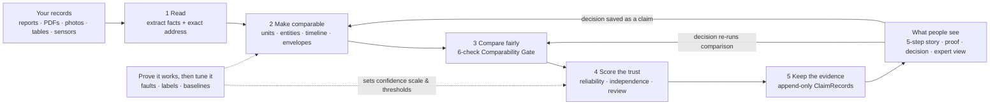
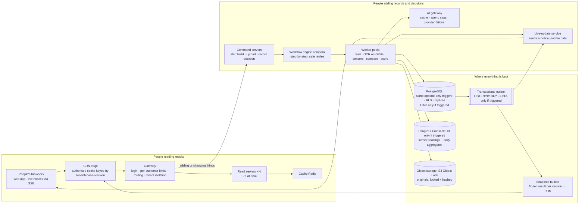

# TRACE — Product Requirements Document

**TRACE: Traceable Reasoning Across Cross-modal Evidence**
*Every fact has an address. Every conflict stays visible.*

| Field | Value |
|---|---|
| Problem statement | Unified Multimodal Evidence Representation with Provenance, Temporal Alignment and Conflict Detection |
| Document | Product Requirements Document (PRD) |
| Event | 10th Edition TECHgium — Presentation Round |
| PID | TG0906436 |
| Team | Nishok Kumar R · Sakthivel R · Shwetha P · Shanmiya T P |
| Institution | Rathinam Technical Campus, Coimbatore, Tamil Nadu |
| Version | 1.2 (synced with the deck, plus the 29 binding changes from the system-design debate: [`system-design/`](system-design/README.md)) |
| Date | 2026-11-20 |
| Status | Draft for build (36-hour hackathon core + stretch + planned production design) |

> **Single source of truth.** The demo *story* and *IDs* match the presentation deck: Machine 21, 14 March, claims C-17 and S-88, error 3 and error 4, "Press 21", 6.9 bar and 100 psi.
>
> **Demo numbers are computed by the engine from the raw data.** This covers the alarm band, peak values, confidence scores and the baseline answer. Where a computed value differs from the deck, **the deck is updated**, never the engine. Authored and planted values are badged as such in the UI. Values shown below in ⟨angle brackets⟩ are filled in from the engine's output. §24 maps each slide to a PRD section.
>
> **Architecture:** see [`system-design/SYSTEM_DESIGN.md`](system-design/SYSTEM_DESIGN.md). The binding decisions are in [`system-design/DECISIONS.md`](system-design/DECISIONS.md), and the threat model is in [`system-design/HARDENING.md`](system-design/HARDENING.md).

---

## Table of contents
1. [Executive summary](#1-executive-summary)
2. [Goals and non-goals](#2-goals-and-non-goals)
3. [Problem statement and background](#3-problem-statement-and-background)
4. [Users, personas and user stories](#4-users-personas-and-user-stories)
5. [Scope and build status](#5-scope-and-build-status)
6. [System overview](#6-system-overview)
7. [Design principles](#7-design-principles)
8. [Functional requirements](#8-functional-requirements)
9. [Data model and schemas](#9-data-model-and-schemas)
10. [Key algorithms and rules](#10-key-algorithms-and-rules)
11. [Demonstration scenarios](#11-demonstration-scenarios)
12. [Evaluation, confidence and calibration](#12-evaluation-confidence-and-calibration)
13. [API specification](#13-api-specification)
14. [Technology stack](#14-technology-stack)
15. [Production architecture (planned)](#15-production-architecture-planned)
16. [Non-functional requirements](#16-non-functional-requirements)
17. [Risks and mitigations](#17-risks-and-mitigations)
18. [36-hour build plan](#18-36-hour-build-plan)
19. [Requirements traceability matrix](#19-requirements-traceability-matrix)
20. [Glossary](#20-glossary)
21. [Assumptions and open questions](#21-assumptions-and-open-questions)
22. [Cost estimate](#22-cost-estimate)
23. [References](#23-references)
24. [Presentation alignment](#24-presentation-alignment)

---

## 1. Executive summary

Real operations produce information in many forms at once: written reports, photographs, tables of readings, and sensor data recorded over time. Most AI tools turn all of this into numeric embeddings so it can be searched by similarity. That finds related content, but it loses what you need in order to trust an answer:

- which document a fact came from;
- which exact sentence, table cell, image region or sensor window it came from;
- which real-world item it refers to;
- what time it applies to.

The result is that contradictions get smoothed over. Take one machine and one day, reaching an engineer in four forms:

- a maintenance report says *"Machine 21 ran normally."*;
- the vibration sensor shows a spike far above its usual range;
- the error log has two error codes that same day;
- a gauge photo reads the pressure as 6.9 bar.

Typical AI search turns all of these into similarity numbers and mixes them. Its answer is something like *"Machine 21: probably fine"*, with a similarity score but no source and no time. (The demo shows the baseline's *actual* output, computed offline and recorded in the eval report; see §12.3.) That answer cannot tell you which document, sentence or cell said it. It cannot tell you when the fact was true and when it was written down. And it cannot tell you that the report and the sensor actually disagreed.

**TRACE** is an engine plus a web app. It turns messy multimodal records into **one structured, inspectable state per case**:

- **Every fact is a `ClaimRecord`.** It points to its exact origin: a text span, an image region, a table cell or a sensor window. It is marked **extracted** (read directly) or **inferred** (worked out, listing its parents). It carries a **confidence** score and separate **valid time** and **observed time**.
- **Facts are linked, not squashed.** The links run through the same **entities**, **events**, **measurements** and **timestamps**, on **one shared timeline**.
- **LLMs assist with extraction only; deterministic rules decide conflicts.** A **Comparability Gate** raises a conflict only when two claims meet all of these conditions:
  - they refer to the same resolved entity and attribute;
  - their valid times overlap;
  - they can be compared after unit normalisation;
  - both sides have real data;
  - they still differ beyond measurement tolerance or normal variation.
- **Conflicts are never averaged away.** Both sides are always kept and shown with their evidence.
- **Qualitative statements become checkable.** A phrase like *"ran normally"* maps to a **machine-specific operating envelope** learned from that machine's own quiet history, so it can be tested against telemetry.
- **Missing data is explicit.** Sensor dropouts become **gap claims**, so "no data" never reads as "normal".
- **Ambiguity stays visible.** Ambiguous entity matches stay as **ranked candidates** for human review.
- **A person stays in charge.** Their decisions are saved as facts of their own, with name and reason, and the comparison re-runs immediately.
- **Confidence is checked against known answers.** We report accuracy and calibration (ECE, Brier, reliability diagram).
- **Robustness is demonstrated** on injected faults: unit swaps, aliases, removed sources and time shifts.

The demo uses **Microsoft's public Azure Predictive Maintenance dataset** (telemetry, errors, maintenance, failures, machines). We add **synthetic evidence we author**: typed maintenance reports, PDFs and photos of gauges, paper forms and nameplates.

---

## 2. Goals and non-goals

### 2.1 Goals
| ID | Goal | Measured by |
|---|---|---|
| G1 | Ingest **text, images, tables/logs and sensor time series** into one per-case state | All 4 modalities produce ClaimRecords in the demo case |
| G2 | **Every fact has an address**: a claim-level evidence pointer for every modality | 100% of claims have a resolvable `EvidencePointer`; the proof highlight works for each type |
| G3 | Separate **extracted vs. inferred** claims; inferred claims list their parents | Schema validation; 0 inferred claims without `derived_from` |
| G4 | **Cross-modal entity linking** that tolerates different names | Entity-linking accuracy ≥ 0.90 on the alias test set; ambiguous cases routed to review |
| G5 | **One shared timeline** with valid time separate from observed time | All claims placed; time-shift faults detected |
| G6 | **Conflicts only when genuinely comparable**; never averaged | Conflict precision ≥ 0.90, recall ≥ 0.85 on injected faults; 0 averaged values |
| G7 | **Confidence reporting** with accuracy and calibration | Accuracy per bin, ECE, Brier, reliability diagram published |
| G8 | **Inspection interface**: from any claim to its exact source in one click | "Show me the proof" works for all modalities |
| G9 | **Robustness demos**: missing source, ambiguous name, unit differences, cross-modal disagreement | 4 scripted demos + headline demo pass |
| G10 | **Human in charge**: decisions are recorded as claims and trigger re-comparison | Decision → re-run → updated card in < 2 s |

### 2.2 Non-goals
- **No averaging, voting-away or silent fusion of conflicting values.** Both sides are always stored and shown.
- **No LLM decides whether two facts conflict.** LLMs only propose extractions, and every quote they return must match the source word for word.
- **No guessing units.** An unknown unit stays unconverted, and the claim is marked "cannot be compared".
- **No auto-merging of ambiguous entities.** Unclear names remain a ranked candidate list until a person decides.
- **No editing of evidence.** Records are append-only, original files are hash-checked, and versions are frozen.
- Not a predictive-maintenance model. TRACE does not predict failures; it reports what the evidence says and where it disagrees.
- Not a general embedding or vector search product. Embeddings may be used as a *baseline* or to propose candidates, never as the fact store.

---

## 3. Problem statement and background

### 3.1 The challenge (verbatim intent)
Build an engine that:

- **reads information arriving in several forms**: text, images, tables, sensor readings over time;
- **turns it into one structured, inspectable picture per case**, covering:
  - *what is involved*;
  - *what happened*;
  - *what was measured*;
  - *in what units*;
  - *at what time*;
  - *how it all relates*;
- **stores every fact** with:
  - a pointer back to its **exact source location**;
  - **when it applies**;
  - **how confident** the system is;
  - whether it was **read directly or worked out**;
- **recognises the same real-world item** across sources even when it is named differently;
- **places events on a shared timeline**;
- **flags a conflict only** when two facts genuinely describe the **same thing at the same time in comparable terms**;
- **keeps conflicts visible**, never averaged away;
- **checks confidence scores against known answers**;
- **shows its behaviour** when a source is **missing**, a name is **ambiguous**, **units differ**, or **two sources disagree**.

### 3.2 Why current approaches fail
| Typical approach | What is lost |
|---|---|
| Embed everything, then do similarity search | Which document, sentence or cell; which item; which time. Contradictory passages may never both be retrieved. |
| LLM summarisation over retrieved chunks | Fluent text that blends sources. Contradictions get "resolved" by the model without telling anyone. |
| Numeric fusion / averaging | A report saying "normal" plus a sensor saying "spike" becomes "slightly elevated", a value that nobody actually observed. |
| Treating missing data as absent | A dead sensor reads as "no anomaly", which is a false "normal". |

### 3.3 Our stance: link, don't squash
Linking sources does **not** mean compressing them into one number. TRACE connects sources through **the same items, events, measurements and timestamps**, and every fact keeps pointing back to where it came from.

Canonical example: a maintenance report says a machine **ran normally** on a day when its sensor shows an **overheating / abnormal spike**. TRACE shows **both statements**, each with its proof, and **flags the clash**.

> Dataset note: the Microsoft dataset has `volt`, `rotate`, `pressure` and `vibration` channels, but no temperature. The headline demo therefore uses **vibration** (plus same-day error codes). An **optional synthetic `temperature` channel** for one machine is generated so the problem statement's exact "overheating spike" example can be shown too. It is labelled synthetic in the UI.
>
> Load note: the dataset has no load channel. Where the deck talks about "normal at the same load", TRACE uses **rotation speed (`rotate`) as the load stand-in** (see FR-NORM-4).

---

## 4. Users, personas and user stories

| Persona | Needs | Main view |
|---|---|---|
| **Operator / non-specialist** (plant supervisor, manager) | A clear answer they can check, without reading raw data | Five-step story |
| **Reviewer / analyst** | To resolve unclear names and doubtful readings, and record why | Review queue, decision panel |
| **Domain expert / engineer** | Every claim, comparison and score, plus thresholds and envelopes | Expert view |
| **Evaluator / judge / auditor** | To verify that facts trace to sources and confidence is honest | Proof highlighter, evaluation report |
| **Integrator** (planned) | To feed records and pull results programmatically | REST API |

### User stories
- **US-1** As an operator, I open a case and read a **five-step story**:
  1. the situation;
  2. what each source says;
  3. whether they agree;
  4. what else happened;
  5. my move.
- **US-2** As an operator, I click **"Show me the proof"** on any statement and see the exact source highlighted: the sentence, cell, image region or sensor window. It is **re-checked just now** against the hash-verified original.
- **US-3** As an analyst, when TRACE is unsure whether "M-21", "Machine 21" and "Press #21" are the same item, I see a **ranked candidate list** with reasons. I **pick one**, and my **name and reason are saved**.
- **US-4** As an analyst, when two photo readers disagree on a gauge value, the fact is **held back for my review** instead of being used.
- **US-5** As an engineer, I can see **why** two claims were or were not compared, through the 6 gate checks with pass/fail and values.
- **US-6** As an engineer, I can see the **operating envelope** that "normal" was mapped to for each machine, and the quiet days it was learned from.
- **US-7** As an auditor, I can see that a sensor **gap** is shown as "we can't tell", not as "normal".
- **US-8** As an evaluator, I can run the **fault-injection benchmark** and see precision/recall, ECE, Brier and the reliability diagram.
- **US-9** As anyone, I can see whether a fact was **read directly** or **worked out**, and for worked-out facts, which facts they came from.

---

## 5. Scope and build status

Status legend: **Built & tested** (core 36-h build, with tests) · **Simulated for now** (works end-to-end on authored demo data; simplified) · **Planned** (designed, not built in the hackathon).

### 5.1 Pipeline components (diagram Part A)
| Stage | Component | Status | Notes |
|---|---|---|---|
| Your records | Typed reports and PDFs ("Machine 21 ran normally.") | Built & tested | |
| Your records | Photos: gauges, paper forms, nameplates | **Simulated for now** | Authored photos. A minimal real OCR path is required for D1 (see FR-ING-4). |
| Your records | Tables and logs: errors, repairs, failures, machine list | Built & tested | MS dataset CSVs |
| Your records | Sensor readings over time: one reading per hour per machine | Built & tested | MS telemetry |
| 1 Read | Rules and phrase lists: "ran normally", numbers and units in typed text | Built & tested | |
| 1 Read | Tables and sensors: every cell keeps its file and line; sensors become daily averages, spikes and gaps | Built & tested | |
| 1 Read | Photo readers: OCR plus a vision model, then a re-read of the cited box | **OCR + re-read: core (working); second reader (VLM): stretch** | The authored photos are demo data, but the reading path is real. The deck's slides 4 and 8 should say "OCR + re-read working; second reader is stretch" rather than "simulated" (see §24). |
| 1 Read | AI language model: reads free-form reports; quotes must match the source word for word | **Planned** (stretch) | Rules cover the core build |
| 2 Make comparable | Units, never guessed: 6.9 bar = 100 psi = 690 kPa; unknown unit stays unconverted | Built & tested | |
| 2 Make comparable | Same machine, different names: an unclear name stays a ranked list until a person decides | Built & tested | |
| 2 Make comparable | One timeline: when a fact applies is kept apart from when it was written down | Built & tested | |
| 2 Make comparable | What "normal" means: learned from each machine's own quiet days | Built & tested | Per machine, from about 30 quiet days |
| 2 Make comparable | "Normal" ranges that know the machine's load (rotation speed as the load stand-in) | **Stretch (Phase 2)** | The core build uses one range per machine and channel |
| 3 Compare fairly | Six checks, in order | Built & tested | |
| 3 Compare fairly | Outcomes: They disagree / They agree / They can't be compared / We can't tell (data missing). Both sides always kept. Never averaged. | Built & tested | |
| 4 Score the trust | Source reliability: starts neutral until we have labelled answers | Built & tested | |
| 4 Score the trust | Agreement from independent sources only: a report made from the sensor file does not confirm it | Built & tested | |
| 4 Score the trust | Doubtful? Ask a person: disagreeing readers hold a fact back for review | Built & tested | |
| 4 Score the trust | Calibrated confidence: tested against known answers, so 0.9 really means 9 in 10 | **Planned** (stretch: evaluation in core, recalibration as stretch) | |
| 5 Keep the evidence | Every fact has an address: what it says, when it applies, which source, which exact spot | Built & tested | |
| 5 Keep the evidence | Read directly, or worked out: worked-out facts list the facts they came from | Built & tested | |
| 5 Keep the evidence | Only ever added to: versions frozen, original files hash-checked | Built & tested | |
| 5 Keep the evidence | Files today, database at scale: PostgreSQL + Citus in the scale design | **Planned** | |
| What people see | A five-step story | Built & tested | |
| What people see | "Show me the proof": highlights the exact line, cell or spot, re-checked just now | Built & tested | |
| What people see | Your decision: resolve an unclear case; your name and reason are saved | Built & tested | |
| What people see | Expert view: every claim, comparison and score | Built & tested | |

### 5.2 Loops (diagram Part B)
| Loop | Status |
|---|---|
| **A person stays in charge.** For an unclear name or a doubtful photo reading, a reviewer decides in the app. The decision is saved **as a fact of its own** (with name and reason), and the comparison **re-runs straight away**. | Built & tested |
| **Prove it works, then tune it.** Stress tests with deliberately injected faults; answers hand-labelled by someone who did not build it; comparison against simple baselines. The results **set the confidence scale and the matching thresholds**. | **Planned** (fault injection + P/R and ECE/Brier in core; automated tuning as stretch) |

### 5.3 Production scale (diagram Part C)
Every box in Part C is **Planned**. See §15.

### 5.4 Core vs. stretch (36 h)
- **Core:**
  - ingestion for all four modalities;
  - ClaimRecords;
  - entity resolution;
  - timeline;
  - unit normalisation;
  - operating envelopes;
  - the Comparability Gate;
  - conflict cards;
  - gap claims;
  - the evidence inspector with exact-source highlighting;
  - the decision loop;
  - fault injection with conflict precision/recall;
  - basic calibration metrics.
- **Stretch (deck Phase 2):**
  - dual-extractor image verification: two independent photo readers must agree (OCR vs. a vision model, with disagreement routed to review);
  - load-aware "normal" ranges, using `rotate` bins as the load stand-in;
  - confidence tuned against labelled answers: full calibration analysis (ECE, Brier, reliability diagrams, temperature/isotonic recalibration);
  - the LLM extractor with verbatim-quote verification;
  - threshold auto-tuning.

---

## 6. System overview



**Data flow per case:**
1. Raw files are stored and hashed (SHA-256).
2. Modality readers emit candidate claims with evidence pointers.
3. The normaliser converts units, resolves entities and assigns time.
4. Claims are grouped by (entity, attribute, time bucket).
5. The gate compares each pair and emits ComparisonRecords.
6. The trust scorer assigns confidence.
7. Everything is written append-only as a new case version.
8. The UI and API read the frozen version.

---

## 7. Design principles
1. **Every fact has an address.** No claim exists without an `EvidencePointer`, and inferred claims point to the claims they came from.
2. **Every conflict stays visible.** Both sides of a disagreement are stored and shown; nothing is averaged.
3. **LLMs assist, rules decide.** Models can propose; deterministic, inspectable rules compare, flag and score.
4. **Never guess.** Unknown units, ambiguous names and missing windows are made explicit ("can't be compared", "ranked candidates", "we can't tell").
5. **"No data" ≠ "normal".** Gaps are first-class claims.
6. **Valid time ≠ observed time.** When a fact applies is stored separately from when it was written down.
7. **Independence matters.** Agreement only counts if the sources are independent.
8. **Append-only.** Versions are frozen, originals are hash-checked, and decisions are new facts rather than edits.
9. **A person stays in charge.** Unclear cases go to a human; their name and reason are kept.
10. **Prove it.** Confidence is checked against known answers; behaviour is shown under faults.

---

## 8. Functional requirements

Priority: **P0** = core 36-h, **P1** = stretch, **P2** = planned.

### 8.1 Ingestion — "Read" (stage 1)

**FR-ING-1 Text and PDF reports (P0)**
- Accept `.txt`, `.md` and `.pdf` (text layer), plus typed maintenance or shift reports.
- Rules and phrase lists extract the following:
  - qualitative status phrases ("ran normally", "no issues", "vibration noticed", "replaced comp2");
  - numbers with units ("pressure 6.9 bar", "100 psi");
  - machine mentions;
  - dates and times;
  - actions.
- Every extracted claim stores:
  - `doc_id`;
  - `page`;
  - `char_start` and `char_end`, which index into the **hashed page-text artifact** (pypdfium2 text-page extraction, sha256 stored as `page_text_sha256`);
  - the exact quoted text and its `quote_sha256`;
  - the PDF bbox, when available.
- **Hidden-text rule.** A text span is **held for review**, not extracted, if any of these is true:
  - its font size is < 4 pt;
  - its bbox lies outside the page CropBox;
  - the greyscale standard deviation of its bbox crop on the server-rendered page PNG is < 8 (on a 0–255 scale), meaning the text is not visible.

  This blocks white-on-white, covered and invisible-render text.
- *Acceptance:* `quote == page_text[char_start:char_end]`, where `page_text` is the hashed extracted-text artifact. A white-text PDF fixture yields 0 claims and 1 review item.

**FR-ING-2 Tables and logs (P0)**
- Accept CSV: `PdM_errors`, `PdM_maint`, `PdM_failures`, `PdM_machines`, and authored repair logs. **XLSX is P1**, which removes the zip-bomb attack surface from the core build.
- Each event log declares a `coverage_period`, the dates it is complete for. This is needed to learn envelopes (§10.3).
- Each cell-derived claim stores `file`, `row` (1-based line in the file), `column`, `raw_value` and `row_sha256` (the raw CSV line bytes).
- *Acceptance:* clicking the proof opens the table scrolled to the exact cell, highlighted.

**FR-ING-3 Sensor time series (P0)**
- Accept `PdM_telemetry`: hourly `volt`, `rotate`, `pressure` and `vibration` per machine. An optional synthetic `temperature` channel is also accepted.
- The telemetry CSV is split once into **one Parquet file per machine**. Each split is a **derived source** with its own sha256 and `derived_from_sources = [telemetry.csv]`. **Raw hourly readings are not claims**; that would be about 3.5 M rows.
- Produce the following derived claims:
  - **day-level sensor-window claims** per channel;
  - **day-level operating-state claims** (S-88 style: robust max-z vs. the conformal T\*, §10.3);
  - **hour-level excursion child claims** (S-88.1 style);
  - **gap claims**, for missing hours, flatlines or conflicting duplicate timestamps (see FR-NORM-5).
- Sensor claims point to a **sensor window**: `series_id`, `machine_id`, `channel(s)`, `start`, `end`, `n_points`, `expected_points`, `statistic`, `granularity` and `window_sha256` (the hash of the canonical Arrow slice).
- Derived claims are typed `claim_type = inferred`, with `derived_from` pointing to the windows and the `envelope_id`.
- Units are `sensor_native` (see FR-NORM-1).
- *Acceptance:* every spike or aggregate claim links to a window that, when re-computed, gives the same value.

**FR-ING-4 Images: gauges, paper forms, nameplates (P0 minimal / P1 full)**
- **P0 (required for deliverable D1):**
  - Images are first EXIF-oriented (`ImageOps.exif_transpose`) and EXIF-stripped into a derived image with its own hash. OCR, bboxes and display all use that image.
  - Run **Tesseract 5 (pinned in the image)** on authored photos and extract text and numbers with **bounding boxes**.
  - **Re-read the cited box with a different configuration**: crop with 8 px padding, upscale ×2, apply Otsu binarisation, and use `--psm 7` with a digit/unit whitelist. This is a **consistency check, not independent verification**.
  - Values outside the gauge's **declared physical range** (for example, a dropped decimal: 69 vs. 6.9) go to review.
  - Gauges are digital or printed readouts. **Analogue needle reading is out of scope.**
- The image evidence pointer stores `image_id`, `bbox [x, y, w, h]` with `coord_space = oriented_px`, the reader used and the crop hash.
- **P1 dual-extractor verification:** a vision-language model reads the same region independently. If the OCR and VLM readings disagree beyond tolerance, the claim is **held back for review** (FR-TRUST-3).
- *Acceptance:* the proof view shows the photo with the cited box outlined. The box re-read matches the stored value, or the mismatch is surfaced.

**FR-ING-5 LLM-assisted extraction (P1)**
- An LLM may read free-form reports and propose claims. It must return **verbatim quotes**.
- The LLM has no tools, uses schema output and temperature 0, and its responses are kept in an offline recorded cache.
- The system **verifies** every proposal:
  1. exact match after NFC normalisation and whitespace collapse, with an offset map; the system computes the char offsets itself;
  2. the quote is ≥ 12 characters and unique in the document;
  3. **the value and unit are re-derived from the quote by the rule parser** and must equal the proposal;
  4. the entity always comes from the resolver, never from the LLM;
  5. a qualitative class that differs from the phrase ontology goes to review as an "LLM-only interpretation".
- Any claim that fails verification is **rejected** and logged.
- The LLM never assigns conflict status or final confidence. Prompt injection inside a document therefore cannot change an outcome.
- *Acceptance:* 0 accepted LLM claims with an unmatched quote or a mutated value (50-mutation test). An injection fixture produces no change in outcome.

**FR-ING-6 Provenance capture (P0)**
- Every source file gets a `source_id`, its SHA-256 hash, ingest time, an author/origin label, and a `derived_from_source` link if it was generated from another source. For example, a report written from the sensor file is linked to that file; this feeds independence (FR-TRUST-2).

### 8.2 Normalisation — "Make them comparable" (stage 2)

**FR-NORM-1 Units, never guessed (P0)**
- For **authored sources** (reports, gauges, repair logs), parse units with a units library (pint) into canonical SI per attribute. For example, pressure becomes kPa: 6.9 bar ≈ 100 psi ≈ 690 kPa.
- Both `value` + `unit` (as written) and `normalized_value` + `normalized_unit` are stored.
- An **unknown or missing unit stays unconverted**: `unit_status = "unknown"`. Such a claim is marked *can't be compared* against numeric claims.
- **MS telemetry units are undocumented.** Every telemetry channel has `unit_status = "sensor_native"`, is displayed as "sensor units (undocumented)", and is **never converted**. It is compared only against envelopes learned from the same series. A physical-unit claim vs. telemetry gives **"They can't be compared: telemetry unit undocumented"**. Assuming mm/s or kPa would be exactly the unit guessing this requirement forbids.
- *Acceptance:* the unit-swap faults in §12 are detected; no claim with an unknown unit is ever converted; "mm/s" and "kPa" never appear against telemetry in the API or UI.

**FR-NORM-2 Cross-modal entity resolution (P0)**
- Build an entity registry from `PdM_machines` (machineID, model, age) plus components (`comp1`–`comp4`).
- Resolve mentions such as "Machine 21", "M21", "machine #21", "Press 21", a nameplate serial, and a model + age description to entities.
- The resolver uses, in order:
  - exact ID or serial match;
  - an alias table;
  - fuzzy string match (rapidfuzz);
  - context features: the model, the components mentioned, and whether the date matches the machine's records.
- It outputs a **ranked candidate list with scores and reasons**.
- The mention is auto-linked only if the top score is ≥ `τ_link`, the margin to the second candidate is ≥ `δ_link`, **and at least one non-string feature agrees**. **A serial conflict vetoes a candidate.** Otherwise it stays **ambiguous**: the claim keeps all candidates and goes to the review queue.
- HumanDecisions on entity links are keyed to a stable **mention key** `(source_sha256, locator)`, so they survive extractor-version changes.
- *Acceptance:* alias faults are resolved; genuinely ambiguous mentions are never auto-merged; transposed digits never auto-link.

**FR-NORM-3 One timeline (P0)**
- Every claim has a **`valid_time`** (an interval when the fact applies) and an **`observed_time`** (when it was recorded or written down).
- Relative expressions are resolved against the document date: "yesterday", "on shift 2", "last week".
- **Each case declares `plant_tz`** (demo: `Asia/Kolkata`, shown in the UI). Naive timestamps are interpreted as plant-local (assumption A7). Storage is UTC, and the original is kept.
- All intervals are **half-open `[start, end)`**. A day is `[D 00:00, D+1 00:00)` local.
- Granularity is recorded as hour, shift, day or unknown. **With no document date, granularity is `unknown`. File mtime is never used** as the basis for valid time.
- All claims and events are placed on one per-case timeline.
- *Acceptance:* the timeline view shows report claims, sensor windows, errors, maintenance and failures on the same axis. Time-shift faults are detected.

**FR-NORM-4 What "normal" means: operating envelopes (P0)**
- For each machine, learn an **operating envelope** from that machine's own **quiet days**, using the **split-conformal robust max-z** procedure in §10.3. In summary:
  - **Quiet days:** no error, maintenance or failure within ±3 days; event logs cover the day (otherwise the build refuses); 24/24 h telemetry; outside the case window ±3 days. The target is about 30 per machine.
  - **Statistic:** robust per-channel med/MAD, then the daily statistic `T_d` = the max |z| over all channels and hours.
  - **Threshold:** `T* = T_(⌈0.95(n+1)⌉)`, which **bounds quiet-day false alarms at ≤ 5%**.
  - **Thin history:** n < 19 → T\* pooled across same-model machines; n < 10 → model-level med/MAD; both labelled.
  - **Training policy:** `all_except_case_window` for retrospective cases and the demo; `before_only` for live monitoring.
- **Load-aware ranges (P1 stretch):** the same construction within `rotate` terciles, so a claim is judged at the same load. The core build uses one envelope per machine.
- Qualitative phrases map to envelope checks **with quantifiers** (§10.4). "Ran normally" is a **∀** claim: no violation on any channel and no error events, and agreement **requires 100% coverage**.
- The envelope used is stored as evidence for the inferred claim: `envelope_id` (a content hash), the quiet days with the reason each qualified, n, med/MAD and T\*.
- *Acceptance:*
  - "ran normally" becomes a testable claim;
  - the measured quiet-day false-alarm rate on ≥ 200 holdout machine-days is ≤ 5% (Wilson 95% CI);
  - the expert view shows the envelope.

**FR-NORM-5 Gaps are explicit (P0)**
- Each of these produces a **GapClaim** with the window and the reason:
  - a missing hourly reading or a run of them (`missing`);
  - a flatline, meaning variance ≤ ε over ≥ 6 h, unless a stop or maintenance event explains it (`flatline`);
  - duplicate timestamps with different values (`conflicting_readings`). These are **never averaged**.
- A gap is never interpreted as "normal". Less than 100% coverage never licenses "agree" for a ∀ claim (§10.6).
- *Acceptance:* when a sensor source is removed, the result is "We can't tell (data missing)", not "They agree". A spike hidden inside a gap gives "We can't tell (partial)", never "agree". Deleting readings never moves any outcome toward "agree" (property test).

### 8.3 Comparison — "Compare fairly" (stage 3)

**FR-GATE-1 Six checks, in order (P0)**
Two claims A and B are compared only if **every** check passes. Each check result is recorded.

| # | Check | Fail outcome |
|---|---|---|
| 1 | **Same machine / entity?** Both resolved to the same entity; an ambiguous link fails. | Can't be compared |
| 2 | **Same thing measured?** Same attribute, or attributes mapped by the attribute ontology (e.g. "ran normally" ↔ `operating_state` ↔ envelope over channels) | Can't be compared |
| 3 | **Same time?** Half-open valid-time intervals overlap at a compatible granularity, and time is known | Can't be compared |
| 4 | **Comparable terms?** Both are normalised to the same dimension (an unknown unit fails). For telemetry: the same `series_id` (`sensor_native`), and the claim's `(statistic, granularity)` equals the envelope's. With the P1 stretch, both are also at the same load mode. | Can't be compared |
| 5 | **Any real data on both sides?** Coverage > 0 on each side | We can't tell (data missing) |
| 6 | **Bigger than normal variation?** Numeric: beyond tolerance (§10.5). Qualitative vs. sensor: the **∀/∃ quantifier rules** (§10.4); a ∀ claim agrees only with 100% coverage. | **They disagree** / **They agree** / **We can't tell (partial)** |

**FR-GATE-2 Outcomes (P0)**
Exactly one of the following, plus a reason string:
- **They disagree**
- **They agree**
- **They can't be compared**
- **We can't tell** (data missing, or partial coverage on a ∀ claim)

**FR-GATE-3 Conflict cards (P0)**
Each "They disagree" result creates a `ConflictRecord` and a **conflict card** that shows:
- both claims side by side, each with its source snippet, image crop, table cell or sensor plot;
- the time overlap;
- the gate check table;
- the magnitude of the difference against the tolerance;
- the confidence of each side;
- related events (errors, maintenance, failures) in the window.

**FR-GATE-4 Never averaged (P0)**
- The system never produces a fused or averaged value from conflicting claims.
- Both sides are always persisted and shown.
- *Acceptance:* a test asserts that no derived claim takes conflicting parents and outputs a mean.

**FR-GATE-5 Determinism (P0)**
- The same inputs, thresholds and decisions always give identical outcomes.
- The gate's config (tolerances, thresholds, envelope parameters) is versioned and stored with each comparison.

### 8.4 Trust — "Score the trust" (stage 4)

**FR-TRUST-1 Source reliability (P0)**
- Every source type starts with a **neutral prior** (0.5 on a Beta(1,1) basis).
- The prior is updated only once labelled answers exist (§12).

**FR-TRUST-2 Agreement only from independent sources (P0)**
- Maintain an **independence graph** from provenance (FR-ING-6).
- Corroboration only counts between sources whose provenance is **declared and disjoint**. A report generated from the sensor file **does not confirm** the sensor. **Undeclared provenance gives zero corroboration credit.** Near-duplicate detection (P1) only labels suspected derivation.

**FR-TRUST-3 Doubtful? Ask a person (P0)**
The following are **held back** from final status and put in the **review queue**:
- claims where readers disagree (OCR vs. re-read, or OCR vs. VLM);
- values outside a gauge's declared physical range;
- hidden-text spans (FR-ING-1);
- ambiguous entity links;
- envelope drift (T\* moved more than 10% between versions);
- claims with confidence below `τ_review`.

**Held claims never form gate pairs.**

**FR-TRUST-4 Confidence per claim and per comparison (P0)**
Confidence combines:
- extractor confidence (rule = high, OCR = OCR score, LLM = verified-quote prior);
- entity-link score;
- time-resolution precision;
- unit status;
- source reliability;
- independent corroboration.

The components are stored so the score is explainable.

**FR-TRUST-5 Calibrated confidence (P1/P2)**
Map raw scores to calibrated probabilities (Platt / isotonic) fitted on held-out labelled answers, so **0.9 really means 9 in 10**. Until calibration exists, the UI marks scores as "uncalibrated".

### 8.5 Evidence store — "Keep the evidence" (stage 5)

**FR-EVID-1 Every fact has an address (P0)**
Every claim stores:
- what it says;
- when it applies;
- which source;
- which exact spot;
- read directly or worked out;
- confidence.

**FR-EVID-2 Extracted vs. inferred (P0)**
- `claim_type ∈ {extracted, inferred}`.
- Inferred claims **must** list `derived_from` (claim IDs) and the `rule_id` or method that produced them.

**FR-EVID-3 Only ever added to (P0)**
- Claims and comparisons are immutable. Each case processing run produces a **frozen version**. Version membership is recorded in `version_claims`, and claims carry no version field.
- Corrections and decisions are new records that **supersede** old ones; they do not modify them.
- **`ReviewItem.status` and `ConflictRecord.status` are derived from append-only review events and decisions, never updated.**
- Enforcement:
  - `BEFORE UPDATE` and `BEFORE DELETE` triggers abort on every evidence table;
  - each record has `record_hash = sha256(JCS(body − wall-clock fields))`;
  - each version's `manifest_hash` is chained to its parent;
  - demo roots are **pushed to the remote git repository** as an external anchor.
- Originals and the cited spot (quote, crop, CSV row, sensor window) are **hash-checked** on every proof view.

**FR-EVID-4 Storage (P0 files / P2 DB)**
- **Hackathon:** one SQLite database (WAL) with append-only triggers, a content-addressed blob store (`blobs/sha256/…`, read-only), Parquet per machine, and hashed JSON snapshots per version.
- **At scale:** PostgreSQL with the same triggers, REVOKE and RLS, plus read replicas. Citus only if the trigger in §15 is met.

### 8.6 Interface — "What people see" (web app via REST API)

**FR-UI-1 Case list and five-step story (P0)**
For each case, show:
1. **Situation**: machine, period, what triggered the case.
2. **What each source says**: one line per source, with modality icons.
3. **Do they agree?**: conflict, agreement, can't-compare and can't-tell badges.
4. **What else happened**: errors, maintenance and failures on the timeline.
5. **Your move**: suggested next action plus the open review items.

**FR-UI-2 "Show me the proof" (P0)**
Any claim opens an evidence panel that highlights the exact spot:
- a **text** span highlighted on a **server-rendered page PNG** (150 dpi), with the bbox overlay and the span shown as plain text nodes. No PDF bytes reach the browser and there is no pdf.js;
- an **image** with the bbox outlined, plus the crop, using the EXIF-stripped derived image;
- a **table** window (±25 rows) scrolled to the highlighted cell;
- a **sensor** chart with the window shaded, the **alarm band** (`med ± T*·s`) drawn, and the p5–p95 "typical" range shaded lighter.

The panel shows a "**re-checked just now**" badge after re-hashing the source and re-extracting the cited value.

**FR-UI-3 Timeline view (P0)**
All claims, events and gaps for the case appear on one axis, with valid time and observed time both visible.

**FR-UI-4 Your decision (P0)**
- Covers resolving an ambiguous entity, accepting or rejecting a doubtful reading, and marking a conflict as explained.
- The conflict card has the actions **Show me the proof**, **Resolve** and **Escalate**. Escalate sends the case to a senior reviewer, and an unresolved item older than 1 working day escalates automatically (assumption A6).
- **The reviewer identity comes from the authenticated session** (per-user argon2id login). It is never taken from the request. A reason of **at least 15 characters** is required.
- The decision request carries `{choice, reason, base_version, shown_evidence_hash}`. A request that includes a `reviewer` field is rejected with 422.
- **409** is returned only if the item is **already decided** or its **evidence has changed** since it was shown. Overriding an existing decision needs `senior_reviewer` and an explicit `supersedes` field.
- "Mark conflict explained" adds a badge and a reason. It never changes the outcome or hides the card.
- The decision is saved as a `HumanDecision` claim plus a review event, and the comparison **re-runs immediately** (link → gate → trust → snapshot over cached claims, in under 2 s).

**FR-UI-5 Expert view (P0)**
Tables of every claim, every comparison (with the 6 check results), every score component, the envelopes and the config version. Filters: modality, extracted/inferred, outcome.

**FR-UI-6 Evaluation dashboard (P1)**
Precision/recall per fault type, entity-linking accuracy, accuracy per confidence bin, ECE, Brier and the reliability diagram.

**FR-UI-7 Live updates (P1)**
A "this case changed" notice over **Server-Sent Events (SSE)** when a new version is ready. Until then, the UI polls the build status every second. WebSocket is not used.

**FR-UI-8 Integrity and replay (P0)**
The expert view shows:
- the version's `manifest_hash`, which matches the pushed anchor;
- an integrity badge (green or red) from re-walking the chain;
- a **Verify replay** button that rebuilds from cached artifacts and compares the hash.

Every card and panel shows the version it belongs to.

### 8.7 Loops (Part B)

**FR-LOOP-1 A person stays in charge (P0)**
Review queue → decision → saved as its own fact (with name and reason) → gate re-run → updated story and cards. The audit trail shows who decided what and why.

**FR-LOOP-2 Prove it works, then tune it (P0 eval / P1 tuning)**
- Run stress tests with deliberately injected faults.
- Use answers hand-labelled by someone who **did not build** the system.
- Compare against simple baselines.
- Outputs set the **confidence scale** (calibration) and the **matching thresholds** (`τ_link`, `δ_link`, tolerances, `τ_review`).

---

## 9. Data model and schemas

### 9.1 Unified Case State
One per case. It is the **structured, inspectable picture** of:

- what is involved (**entities**);
- what happened (**events**);
- what was measured (**measurements**);
- in what units;
- at what time (**temporal context**);
- how it all relates (**relations**).

```json
{
  "case_id": "case-m21-2015-03-14",
  "version": 7,
  "manifest_hash": "⟨sha256, chained to version 6⟩",
  "created_at": "2026-11-20T10:02:11Z",
  "config_version": "gate-v1.3+⟨config_hash[:8]⟩",
  "plant_tz": "Asia/Kolkata",
  "scope": { "entities": ["machine:21"], "window": ["2015-03-10T00:00:00Z", "2015-03-17T00:00:00Z"] },
  "sources":      [ /* Source */ ],
  "entities":     [ /* Entity */ ],
  "events":       [ /* Event */ ],
  "measurements": [ /* Measurement */ ],
  "attributes":   [ /* static Attribute e.g. model, age */ ],
  "claims":       [ /* ClaimRecord — the atomic unit; all of the above are views over claims */ ],
  "relations":    [ /* Relation */ ],
  "timeline":     [ /* TimelineEntry ordered by valid_time.start */ ],
  "comparisons":  [ /* ComparisonRecord */ ],
  "conflicts":    [ /* ConflictRecord */ ],
  "gaps":         [ /* GapClaim ids */ ],
  "decisions":    [ /* HumanDecision ids */ ],
  "review_queue": [ /* ReviewItem */ ]
}
```

### 9.2 Core types

**Source**
```json
{ "source_id": "src-report-0314", "modality": "text", "uri": "files/reports/report_0314.pdf",
  "sha256": "9f2c…", "ingested_at": "2026-11-20T09:58:00Z", "origin": "authored-maintenance-report",
  "derived_from_sources": [], "reliability": { "alpha": 1, "beta": 1 } }
```

**Entity**
```json
{ "entity_id": "machine:21", "type": "machine", "canonical_name": "Machine 21",
  "aliases": ["M21", "M-21", "machine #21", "SN-0021"],
  "_note": "'Press 21' is NOT a registered alias: it is the deliberately ambiguous mention in Demo 2 (M-21 0.71 vs M-12 0.22) until a reviewer decides",
  "attributes": { "model": "model3", "age_years": 14 },
  "parts": ["machine:21/comp1", "machine:21/comp2", "machine:21/comp3", "machine:21/comp4"] }
```

> **Time notation in all examples.** Intervals are **half-open `[start, end)`**. Example times are written in plant-local time (`+05:30`, the case's `plant_tz`) for readability. They are **stored as fixed-width UTC** strings (`YYYY-MM-DDTHH:MM:SSZ`), so string order equals time order. A day is `[D 00:00, D+1 00:00)` local.

**Event**: something that happened (error, maintenance, failure, inspection, report filed)
```json
{ "event_id": "ev-err-0314-1400", "type": "error", "code": "error4", "entity_id": "machine:21",
  "valid_time": { "start": "2015-03-14T14:00+05:30", "end": "2015-03-14T15:00+05:30", "granularity": "hour" },
  "claim_ids": ["clm-err-row815"] }
```
(The same day also has `error3` at 10:00, from table row 812.)
```json
{ "event_id": "ev-shift-0314", "type": "shift", "entity_id": "machine:21",
  "valid_time": { "start": "2015-03-14T00:00+05:30", "end": "2015-03-15T00:00+05:30", "granularity": "shift" },
  "claim_ids": ["C-17"] }
```

**Measurement**: what was measured, the value, the unit and the window
```json
{ "measurement_id": "ms-…", "entity_id": "machine:21", "quantity": "vibration",
  "statistic": "hourly_peak", "value": "⟨computed, e.g. 64⟩",
  "unit": "sensor_native", "unit_status": "sensor_native", "normalized_value": null, "normalized_unit": null,
  "valid_time": { "start": "2015-03-14T14:00+05:30", "end": "2015-03-14T15:00+05:30", "granularity": "hour" },
  "claim_id": "S-88.1" }
```
MS telemetry units are undocumented. They are shown as "sensor units (undocumented)" and never converted (see FR-NORM-1).

**Relation**: how things relate
```json
{ "relation_id": "rel-…", "type": "measured_on | occurred_on | part_of | mentions | derived_from | supersedes | contradicts | corroborates",
  "from": "ms-…", "to": "machine:21", "claim_id": "clm-…" }
```

**TemporalContext** (used inside every claim)
```json
{ "valid_time":    { "start": "…", "end": "…", "granularity": "hour|shift|day|unknown", "resolved_from": "explicit|relative:'yesterday'|document_date" },
  "observed_time": { "at": "…", "basis": "document_date|file_timestamp|sensor_timestamp|ingest_time" },
  "timezone_original": "Asia/Kolkata" }
```

### 9.3 ClaimRecord (the atomic fact)

```json
{
  "claim_id": "clm_3f9a…(sha256 of semantic fields + pointer + method, 24 hex)",
  "label": "C-17",
  "case_id": "case-m21-2015-03-14",
  "claim_type": "extracted",
  "statement": "Machine 21 ran normally through both shifts on 14 March 2015",
  "subject": {
    "mention": "Machine 21",
    "entity_id": "machine:21",
    "link_status": "resolved",
    "candidates": [ { "entity_id": "machine:21", "score": 0.97, "reasons": ["exact alias"] } ]
  },
  "attribute": "operating_state",
  "value": "normal",
  "value_type": "categorical",
  "unit": null,
  "unit_status": "not_applicable",
  "normalized_value": null,
  "normalized_unit": null,
  "temporal": {
    "valid_time": { "start": "2015-03-14T00:00+05:30", "end": "2015-03-15T00:00+05:30", "granularity": "day", "resolved_from": "explicit" },
    "observed_time": { "at": "2015-03-15T09:10+05:30", "basis": "document_date" }
  },
  "modality": "text",
  "evidence": {
    "kind": "text_span",
    "source_id": "src-report-0314",
    "uri": "report_0314.pdf",
    "sha256": "9f2c…",
    "page": 1,
    "line": 4,
    "page_text_sha256": "⟨sha256 of the extracted page-text artifact⟩",
    "char_start": "⟨offset into page_text⟩",
    "char_end": "⟨offset into page_text⟩",
    "quote": "ran normally through both shifts",
    "quote_sha256": "⟨sha256(quote)⟩",
    "bbox": [72, 310, 380, 14]
  },
  "derived_from": [],
  "method": { "extractor": "rules:phrase_list_v2", "extractor_version": "2.0.0", "rule_id": "status.normal", "llm_used": false },
  "confidence": {
    "value": 0.83,
    "calibrated": false,
    "note": "raw score, computed by §10.8 = 0.95 × 0.97 × 0.90 × 1.0 × 1.0 × 1.0; labelled 'uncalibrated' in the UI",
    "components": { "extractor": 0.95, "entity_link": 0.97, "time": 0.90, "unit": 1.0, "reliability_adj": 1.0, "corroboration": 0.0 }
  },
  "supersedes": null,
  "record_hash": "⟨sha256(JCS(body minus wall-clock fields))⟩",
  "created_at": "2026-11-20T10:02:11Z"
}
```
The char offsets and the 0.83 confidence are produced by the engine. The deck's 0.71 must be updated to the computed value (§24).

**Field rules:**
- **Claims carry no version.** Version membership is recorded in `version_claims(case_id, version, claim_id)`. `claim_id` is content-addressed: `"clm_" + sha256(JCS(semantic fields + pointer + method))[:24]`. `label` (for example C-17) is a display alias assigned from `seed/labels.yaml` by mention key.
- **Claims carry no mutable status.** Review state lives in append-only `review_events`, and any status shown is *derived* from them at snapshot time.
- `created_at` and other wall-clock fields are excluded from `record_hash`.
- `claim_type` is **`extracted`** (read directly from a source) or **`inferred`** (worked out). Inferred claims **must** have a non-empty `derived_from` and a `method.rule_id`.
- `evidence` is **required** for extracted claims. For inferred claims it is optional (the parents carry it), but a `computed_window` pointer is used for sensor-derived claims.
- `subject.link_status` is `resolved`, `ambiguous` (keeps the ranked `candidates`) or `unresolved`.
- `unit_status` is `known`, `unknown` (never converted), `sensor_native` (undocumented telemetry units: never converted, compared only against envelopes from the same series) or `not_applicable`.
- Held-for-review is a derived state (see above). Held claims never form gate pairs.

**Example: an inferred claim (S-88, day-level)**
```json
{ "claim_id": "clm_8c41…", "label": "S-88", "claim_type": "inferred",
  "statement": "Machine 21 operating state on 14 Mar 2015 was outside its learned alarm band (robust max-z T_D = ⟨computed⟩ > T* = ⟨computed⟩); largest excursion: vibration ⟨peak, e.g. 64⟩ at 14:00–15:00",
  "subject": { "entity_id": "machine:21", "link_status": "resolved" },
  "attribute": "operating_state", "value": "abnormal", "value_type": "categorical",
  "unit_status": "sensor_native",
  "temporal": { "valid_time": { "start": "2015-03-14T00:00+05:30", "end": "2015-03-15T00:00+05:30", "granularity": "day" },
                "observed_time": { "at": "2015-03-15T00:00+05:30", "basis": "sensor_timestamp" } },
  "modality": "sensor",
  "evidence": { "kind": "sensor_window", "window_id": "W-0314", "source_id": "src-telemetry-m21",
                "series_id": "telemetry/machine:21", "channels": ["volt", "rotate", "pressure", "vibration"],
                "start": "2015-03-14T00:00+05:30", "end": "2015-03-15T00:00+05:30", "n_points": 96, "expected_points": 96,
                "statistic": "robust_max_z", "granularity": "day",
                "T_D": "⟨computed⟩", "T_star": "⟨computed⟩", "window_sha256": "⟨sha256 of Arrow IPC slice⟩",
                "envelope_id": "env_⟨sha256⟩" },
  "derived_from": ["⟨4 sensor-window day claims: volt, rotate, pressure, vibration⟩", "env_⟨sha256⟩"],
  "method": { "extractor": "envelope_check", "extractor_version": "1.0.0", "rule_id": "state.abnormal_if_robust_max_z_gt_conformal_q95" },
  "confidence": { "value": "⟨1 − conformal p-value × coverage × history_factor, computed⟩", "calibrated": false } }
```

**Child claim S-88.1 (hour-level detail).** The largest excursion is an inferred claim with `attribute = "vibration"`, `statistic = "hourly_peak"`, `granularity = "hour"`, valid `[14:00, 15:00)` local, value ⟨computed⟩ in `sensor_native` units, and its own `window_sha256`. S-88 lists it as a child. **C-17 (day) is compared with S-88 (day)**, so check 3 compares like with like. S-88.1 is shown on the chart for explanation.

### 9.4 EvidencePointer (all modalities)

| `kind` | Modality | Required fields | Proof view |
|---|---|---|---|
| `text_span` | text / PDF | `source_id`, `sha256`, `page_text_sha256`, `char_start`, `char_end` (into the hashed page-text artifact), `quote`, `quote_sha256`; optional `page`, `line`, `bbox` | Server-rendered page PNG with bbox overlay + highlighted text span |
| `image_region` | image | `source_id`, `sha256` (of the EXIF-oriented derived image), `bbox [x,y,w,h]`, `coord_space: oriented_px`, `reader` (ocr/vlm), `read_text`, `crop_sha256`; optional `reread_text` | Photo with outlined box + crop |
| `table_cell` | table / log | `source_id`, `sha256`, `row`, `column`, `raw_value`, `row_sha256` (raw CSV line bytes); optional `sheet` (P1 XLSX) | Table window (±25 rows), cell highlighted |
| `sensor_window` | time series | `source_id`, `series_id`, `channel(s)`, `start`, `end`, `n_points`, `expected_points`, `statistic`, `granularity`, `window_sha256`; optional `envelope_id` | Chart with shaded window + alarm band |
| `human_decision` | decision | `decision_id`, `user_id`, `display_name`, `role` (all **from the session**), `reason`, `base_version`, `shown_evidence_hash`, server `timestamp` | Decision log entry |

### 9.5 Other records

**ComparisonRecord**
```json
{ "comparison_id": "cmp-…", "claim_a": "C-17", "claim_b": "S-88", "config_version": "gate-v1.3+⟨hash8⟩",
  "checks": [
    { "n": 1, "name": "same_entity",       "pass": true,  "detail": "M-21 = Machine 21 (machine:21)" },
    { "n": 2, "name": "same_attribute",    "pass": true,  "detail": "'ran normally' (∀: all channels + no error events) ↔ operating_state" },
    { "n": 3, "name": "time_overlap",      "pass": true,  "detail": "both [14 Mar 00:00, 15 Mar 00:00) local, day granularity" },
    { "n": 4, "name": "comparable_terms",  "pass": true,  "detail": "same series scale (sensor_native, series telemetry/machine:21); statistic robust_max_z/day matches envelope" },
    { "n": 5, "name": "data_both_sides",   "pass": true,  "detail": "note present; 96 of 96 hourly readings (100% coverage)" },
    { "n": 6, "name": "beyond_variation",  "pass": true,  "detail": "T_D ⟨computed⟩ > T* ⟨computed⟩ (envelope env_⟨hash⟩); largest excursion vibration ⟨peak⟩ at 14:00" }
  ],
  "outcome": "disagree", "reason": "∀ claim 'ran normally' violated: robust max-z above the alarm band, and error3 at 10:00 + error4 at 14:00 the same day" }
```

**ConflictRecord** (status is *derived* from review events, never stored)
```json
{ "conflict_id": "cf-…", "comparison_ids": ["cmp-…", "cmp-err3-…", "cmp-err4-…"], "sides": ["C-17", "S-88"],
  "supporting_context": ["clm-err-row812", "clm-err-row815", "S-88.1"],
  "magnitude": { "statistic": "robust_max_z", "observed": "⟨T_D⟩", "threshold": "⟨T*⟩", "unit": "unitless (z)" },
  "averaged": false }
```
The display status (open, explained, or dismissed by a reviewer) is computed from append-only `review_events` and decisions. "Explained" adds a badge and a reason. It never changes the outcome or hides the card. All disagreeing pairs that involve C-17 are grouped on one card.

**GapClaim** (a ClaimRecord with `attribute = "data_availability"`)
```json
{ "claim_id": "gap-…", "claim_type": "inferred", "attribute": "data_availability", "value": "missing",
  "subject": { "entity_id": "machine:21" },
  "statement": "Sensor offline 02:00 to 06:00 on 14 Mar: no data, never read as normal",
  "temporal": { "valid_time": { "start": "2015-03-14T02:00+05:30", "end": "2015-03-14T06:00+05:30", "granularity": "hour" } },
  "evidence": { "kind": "sensor_window", "series_id": "telemetry/machine:21/vibration", "n_points": 0, "expected_points": 4 },
  "method": { "rule_id": "gap.missing_hours" } }
```

**HumanDecision** (saved as a fact of its own, i.e. a ClaimRecord with `modality = "decision"`)
```json
{ "claim_id": "dec-…", "claim_type": "extracted", "modality": "decision", "attribute": "entity_link",
  "value": { "mention_claim": "clm-ocr-55", "chosen_entity": "machine:21" },
  "evidence": { "kind": "human_decision", "decision_id": "dec-…", "reviewer": "A. Reviewer", "reason": "'Press 21' is on line 2, which has M-21; nameplate serial SN-0021 matches the asset register", "timestamp": "…" },
  "supersedes": null, "triggers_rerun": true }
```

**ReviewItem**
```json
{ "review_id": "rv-…", "type": "ambiguous_entity | reader_disagreement | low_confidence | unknown_unit",
  "claim_ids": ["…"], "candidates": [ … ], "opened_at": "…" }
```
The review status (open, decided, stale or escalated) is **derived** from append-only `review_events` and decisions, never updated in place. Auto-escalation after 1 working day is computed at read time.

### 9.6 Attribute ontology (excerpt)
| Attribute | Dimension / type | Canonical unit | Sources that can express it |
|---|---|---|---|
| `pressure` (authored sources) | pressure | kPa | gauge photo, report text, repair-log table |
| `pressure` (MS telemetry) | `sensor_native` (undocumented) | — never converted; compared only with same-series envelopes | sensor |
| `vibration` (MS telemetry) | `sensor_native` (undocumented) | — never converted; compared only with same-series envelopes | sensor |
| `voltage` (MS telemetry) | `sensor_native` (undocumented) | — never converted; compared only with same-series envelopes | sensor |
| `rotation` (MS telemetry) | `sensor_native` (undocumented) | — never converted; compared only with same-series envelopes | sensor |
| `voltage` / `rotation` (authored sources) | electric potential / angular speed | V / rpm | report text, nameplate |
| `temperature` (synthetic, authored) | temperature | °C (declared by the generator) | sensor, gauge photo, report text |
| `operating_state` | categorical {normal, abnormal, stopped, unknown} | — | report phrases ↔ envelope checks |
| `error_event` | event code | — | error log, report text |
| `maintenance_action` | event (component replaced) | — | maint log, report text, paper form photo |
| `failure_event` | event (component failed) | — | failure log, report text |
| `data_availability` | {present, missing, flatline} | — | sensor gap detector |

---

## 10. Key algorithms and rules

### 10.1 Entity resolution score
`score = w1·exact_id + w2·alias_hit + w3·fuzzy(mention, names) + w4·context(model, components, date-consistency)`

- Auto-link only if **all three** hold:
  - `score_top ≥ τ_link (0.85)`;
  - `score_top − score_2nd ≥ δ_link (0.15)`;
  - **at least one non-string feature agrees** (model, components, date consistency, or serial).
- **A serial conflict vetoes a candidate.** A named `digit_transposition` feature makes "Press 21" vs. M-12 visible as a reason.
- Otherwise the mention is *ambiguous* and goes to the review queue with the top 3 candidates, their per-feature scores and reasons.
- Weights are tuned on **dev** alias seeds only. Whatever the holdout produces for "Press 21" is what goes on the slide.

### 10.2 Time resolution
- **All intervals are half-open `[start, end)`.** A day is `[D 00:00, D+1 00:00)` in the case's `plant_tz`, stored in UTC as fixed-width strings.
- Explicit dates and times are parsed with dateparser using `RELATIVE_BASE = observed_time`, a fixed `DATE_ORDER` and a fixed `TIMEZONE`.
- Relative expressions resolve against the document's observed time.
- **No document date → `granularity = unknown`**, and check 3 fails with "time unknown". **File mtime is never used** as the basis for valid time.
- Naive dataset timestamps are interpreted as plant-local and labelled "assumed plant-local" (assumption A7).
- Shifts map to configured hours. The demo uses two 12-hour shifts.
- Intervals overlap if `max(startA, startB) < min(endA, endB)`. Day-level text is compared with day-level sensor claims, never with single hours. Check 4 enforces this through `(statistic, granularity)`.

### 10.3 Operating envelope: split-conformal robust max-z
This replaces the earlier p5–p95 rule. Testing every hourly value of 4 channels against p5–p95 is about 96 tests a day at about 10% each, so almost every quiet day would read "disagree" (threat T-01 in `system-design/HARDENING.md`).

For machine *m*:
1. **Quiet days Q.** A day is quiet only if **all** of the following hold:
   - no error, maintenance or failure within ±3 days;
   - every event log's declared `coverage_period` covers the day (otherwise the build refuses with `/problems/log-coverage`);
   - telemetry has **24/24 hours on every channel**;
   - the day is **outside the case window ±3 days**.

   **Training policy** is a config value: `all_except_case_window` for retrospective cases, including the demo, and `before_only` for live production monitoring.
2. **Per-channel robust centre and scale** from the hourly values over Q: `med_c` and `s_c = 1.4826·MAD_c`. If `MAD_c = 0`, the channel is excluded and listed as "degenerate scale".
3. **Daily family statistic** over the channels *C* in the phrase's scope: `T_d = max_{c∈C, h∈d} |x_{c,h} − med_c| / s_c`. This is one test per day.
4. **Threshold** `T* = T_(k)`, the k-th smallest of `{T_d : d ∈ Q}`, with `k = ⌈(1−α)(n+1)⌉`, `α = 0.05`, `n = |Q|`.
   - By split-conformal exchangeability, **P(false alarm on a new quiet day) ≤ α**.
   - **n < 19:** T\* is pooled across all machines of the same model (T_d is unitless).
   - **n < 10:** `med_c` and `s_c` also come from the model level.
   - Either fallback is labelled "thin history / model-level".
5. **Displayed alarm band** per channel: `med_c ± T*·s_c`. The hourly p5–p95 range may be shaded lighter, labelled "typical, not the alarm threshold".
6. **Envelope identity:** `envelope_id = sha256(machine, channel scope, statistic="robust_max_z", granularity="day", sorted quiet days, params, data partition hashes)`. Check 4 requires the claim's `(statistic, granularity, series_id)` to equal the envelope's.
7. **Drift guard:** if T\* moves more than 10% between versions, a review item opens.
8. **Load-aware (P1 stretch):** the same construction inside each `rotate` tercile, used as the load proxy.

The demo's band and peak values are **computed** by this procedure and shown in the Envelope view, together with the quiet-day list, n, med/MAD and T\*. The number of quiet days is measured at h0. The target is about 30 per machine (assumption A4).

### 10.4 Qualitative → quantitative mapping, with quantifiers
| Phrase class | Quantifier | Scope | Mapped check |
|---|---|---|---|
| "ran normally", "no issues", "all good" | **∀** | All channels + no error events | No violation (`T_D ≤ T*`) **and** no error, failure or maintenance event in the window |
| "high vibration", "shaking", "vibration noticed" | **∃** | vibration | Some violation (`T_D > T*`, upper side) |
| "pressure low" | **∃** | pressure, lower side | Some violation below `med − T*·s` |
| "stopped", "down" | **∃** | rotate stop or event | rotate at stop level, or a failure/maintenance event |

**Outcome rules (check 6):**
- **∀ phrase:**
  - **disagree** if any violation is observed in the available hours, or there is an error/failure event;
  - **agree** only with **100% coverage** of every channel in scope, `T_D ≤ T*`, and logs covering the window;
  - otherwise **"We can't tell (partial: n h missing)"**.
- **∃ phrase:**
  - **agree** if a violation is observed;
  - **disagree** only with full coverage and no violation;
  - otherwise "We can't tell (partial)".
- Disagreeing on partial data is conservative, because the max is taken over fewer tests.

### 10.5 Tolerance (check 6)
- **Numeric vs. numeric** (same physical unit, authored sources): disagree if `|a − b| > max(abs_tol_attr, rel_tol_attr·|ref|, measurement_resolution_a + measurement_resolution_b)`. Tolerances come from sensor datasheets (assumption A5).
- **Qualitative vs. sensor:** the quantifier rules in §10.4.
- **Physical unit vs. `sensor_native`** (for example, gauge in bar vs. MS telemetry pressure): fails check 4, giving **"They can't be compared: telemetry unit undocumented"**.

### 10.6 Gap detection
- Expected cadence: 1 h.
- **Missing readings:** any coverage below 100% creates `GapClaim(missing)` for the missing hours. **This never licenses "agree" for a ∀ claim.** The 80% `min_coverage` threshold only controls how a gap is labelled.
- **Zero coverage on a side** fails check 5, giving "We can't tell (data missing)".
- **Partial coverage** passes check 5 and flows into the quantifier rules in §10.4.
- **Flatline:** variance ≤ ε (`ε = 1e-6·s_c`) over ≥ 6 h creates `GapClaim(flatline)`, **unless** a stop or maintenance event explains it, in which case it is "stopped".
- **Duplicate `(machine, channel, timestamp)` readings with different values are never averaged.** That hour becomes `GapClaim(conflicting_readings)`.

### 10.7 Independence graph
- Nodes are sources. A directed edge `A → B` means B was derived from A, according to **declared** provenance (`derived_from_sources`).
- Two claims corroborate only if their sources have **declared, disjoint** provenance. **Undeclared provenance gives zero corroboration credit.**
- Near-duplicate-number detection (P1) only *labels* suspected derivation for review. It never grants credit.

### 10.8 Confidence composition (pre-calibration)
`raw = extractor × entity_link × time_precision × unit_factor × reliability_adj × (1 + λ·independent_corroboration)`, clipped to [0, 1].

- `reliability_adj = 0.5 + r`, where r is the source reliability. The neutral prior r = 0.5 maps to 1.0. `λ = 0.2`.
- Image extractor prior is 0.80. Text rules are 0.95.
- **Sensor-state claims** use `1 − p`, where `p = (1 + #{d ∈ Q : T_d ≥ T_D}) / (n + 1)` is the conformal p-value, multiplied by `coverage_fraction` and by `history_factor` (1.0, or 0.8 for thin history).
- **Worked example:** C-17 = 0.95 × 0.97 × 0.90 × 1.0 × 1.0 × 1.0 = **0.83**.
- All components are stored, and every score is labelled **"uncalibrated"** until the calibration fit exists.
- Calibration (Platt or isotonic) maps `raw` to `p`. It is fitted on the labelled dev set and evaluated on the holdout.

---

## 11. Demonstration scenarios

**Data:** Microsoft Azure Predictive Maintenance public dataset, used under its license:

- `PdM_telemetry`: hourly volt, rotate, pressure and vibration for 100 machines in 2015;
- `PdM_errors`;
- `PdM_maint`;
- `PdM_failures`;
- `PdM_machines`.

**Synthetic evidence we author:**
- typed maintenance and shift reports (text and PDF);
- photos of gauges, paper maintenance forms and nameplates;
- a repair log CSV;
- an optional synthetic temperature channel for one machine.

Reports and photos are clearly labelled "written for the demo".

### Demo 0 — Headline: cross-modal disagreement (the problem-statement example; deck slides 2, 3, 6, 7)
- **Setup:** one machine and one day in four forms:
  - `report_0314.pdf`, page 1, line 4: *"Machine 21 ran normally through both shifts."* This becomes claim **C-17** (extracted, ∀ phrase, raw confidence **0.83** computed). It was written on 15 Mar at 09:10.
  - Telemetry on 14 Mar gives claim **S-88** (day-level, inferred from window **W-0314**). Its robust max-z `T_D` exceeds the machine's conformal threshold `T*`. The largest excursion is child claim **S-88.1**: vibration peaks at ⟨computed; the deck shows 64⟩ between 14:00 and 15:00, outside the alarm band ⟨med ± T\*·s, computed⟩. S-88's confidence is ⟨computed⟩.
  - The error log shows **error 3 at 10:00** (table row 812) and **error 4 at 14:00** (table row 815).
  - A gauge photo reads the pressure as **6.9 bar**.
- **Before the build (h0 reality check):** confirm that the real data for M-21 on 14 Mar exceeds T\* and has those error rows. If it doesn't, choose the real machine-day that does and update the deck, or plant the values with the seeded injector and badge them "planted for the demo".
- **Along the way:**
  - "Machine 21", "M-21" and the nameplate serial are linked to one machine.
  - A daily summary report copied from the sensor file is **not** counted as a second witness.
- **Expected outcome:**
  - **They disagree.** A red conflict card shows the note sentence (highlighted span on the page image) and the sensor window side by side. The chart shades the window, draws the alarm band, and marks the S-88.1 peak. The two error rows are highlighted as supporting context.
  - The gate table shows all 6 checks passed.
  - Both sides are kept, and no averaged value appears.
  - The reviewer can choose **Show me the proof**, **Resolve** or **Escalate**. Any decision is saved with the reviewer identity taken from the login session, plus a reason.
- **Baseline contrast:** the offline baseline (TF-IDF top-k retrieval plus an averaging / last-write-wins answer) is run on the same records. Its **actual** output is shown and recorded in the eval report: typically a "probably fine" style answer with no source and no time.
- **Variant:** the synthetic temperature channel shows an overheating spike, reproducing the statement's exact example.

### Demo 1 — Missing data (source missing / sensor dropout)
- **Setup:**
  - **(a)** The sensor is offline from 02:00 to 06:00 on 14 Mar (deck slide 7).
  - **(b)** All vibration telemetry for Machine 21 on 14 Mar is deleted, or the whole telemetry source is dropped.
- **Expected outcome:**
  - **(a)** A **GapClaim(missing)** covers [02:00, 06:00). The day has 20 of 24 readings, so check 5 passes, and the ∀ rule decides:
    - **"They disagree"** if a violation is observed in the 20 available hours (here the 14:00 excursion and the error events);
    - if the violating hours fall *inside* the gap, **"We can't tell (partial: 4 h missing)"**;
    - **never "They agree"**, because a ∀ claim needs 100% coverage to agree.

    The gap is shown on the timeline.
  - **(b)** A **GapClaim** covers the whole day.
  - The gate fails check 5, giving **"We can't tell (data missing)"**. It is **not** "They agree".
  - The story says the sensor data for that day is missing, so the report cannot be confirmed.
  - Removing the report instead leaves the sensor claim standing alone, with no fabricated agreement.

### Demo 2 — Entity ambiguity
- **Setup:** a paper-form photo says **"Press 21"**. It could be M-21, or M-12 with transposed digits.
- **Expected outcome:**
  - The mention keeps a **ranked candidate list**, for example **M-21 at 0.71, M-12 at 0.22** (the deck's values). The final scores are whatever the resolver, tuned on dev seeds only, produces on this input, and the slide is updated to match. Each candidate shows its per-feature reasons: fuzzy name, `digit_transposition`, date consistency, components on the form.
  - Auto-link needs score ≥ 0.85, a margin ≥ 0.15 and an agreeing non-string feature. The top score fails that, so **both stay ranked until a person picks**.
  - It is **held for review**, so the gate fails check 1 ("can't be compared yet").
  - The reviewer picks Machine 21 with a reason. A HumanDecision claim is saved, the comparison **re-runs**, and the conflict card updates.

### Demo 3 — Units differ
- **Setup:** a gauge photo reads **"6.9 bar"** and a repair log says **"100 psi"** (deck slide 7). A fourth source gives "pressure 7.2" with no unit. MS telemetry pressure is also present, but its unit is undocumented.
- **Expected outcome:**
  - 6.9 bar = 690 kPa and 100 psi ≈ 689.5 kPa, so both become **≈ 690 kPa**. **They agree** within tolerance, and nothing is flagged.
  - **Gauge 6.9 bar vs. telemetry pressure → "They can't be compared (telemetry unit undocumented)."** Telemetry is `sensor_native` and is never converted.
  - "7.2" with no unit is **left unconverted**, giving **"They can't be compared"** with the reason "unknown unit".
  - **Unit swap fault:** when a report value is relabelled from bar to psi, the gate detects a disagreement.

### Demo 4 — Two sources disagree, but not comparable (false-conflict guard)
- **Setup:** a report says "Machine 21 ran normally on 10 March", while the sensor spike is on 14 March. Alternatively, the report is about Machine 22.
- **Expected outcome:** **"They can't be compared"**, because check 3 (time) or check 1 (entity) fails. No conflict is raised. This shows TRACE only flags *genuine* conflicts.

### Demo 5 — Independence
- **Setup:** an auto-generated daily summary report is created *from* the telemetry file and says "vibration elevated".
- **Expected outcome:** it does **not** count as independent corroboration of the sensor claim; the confidence is unchanged. The expert view shows the provenance edge.

### Demo 5b — Late timestamp
- **Setup:** the note is written a day later (observed 15 Mar 09:10, valid 14 Mar).
- **Expected outcome:** it is aligned by **when it applied**, not when it was written, so it is still compared with the 14 Mar sensor window. If the injected fault moves the *valid* date, check 3 fails, giving "can't be compared".

### Demo 6 — Reader disagreement on a photo (stretch)
- **Setup:**
  - **(P0)** OCR reads a gauge as "69" when the gauge's declared physical range is 0–16 bar (a dropped decimal).
  - **(P1)** OCR reads "6.9" and the independent VLM reader reads "8.9".
- **Expected outcome:** the claim is **held back for review**, and the fact is not used in comparisons until a decision is made. The OCR re-read is labelled a *consistency check*, not independent verification.

---

## 12. Evaluation, confidence and calibration

### 12.1 Test sets
- **Fault-injected cases** (stress tests): a **seeded** fault injector (so every run can be repeated) plants faults in real telemetry and authored evidence. The expected behaviour for each fault type, as on deck slide 10:

  | Fault planted | What TRACE must do |
  |---|---|
  | **Unit swap** (psi, bar or kPa) | Convert first, then agree. No false alarm. A *mislabelled* unit must surface as a disagreement. |
  | **Name alias** ("Press 21", "M21") | Link the right machine, or ask a person |
  | **Removed source** (sensor hours deleted) | Record a gap, never "normal" |
  | **Contradicting note** ("ran normally" on a fault day) | Raise a conflict with both sources cited |
  | **Late timestamp** (note written a day later) | Align by when it applied, not when it was written |

  The faults injected:
  - **unit swaps** (bar ↔ psi; kPa ↔ bar mislabels);
  - **aliases** (renamed machines, typos, nameplate serials);
  - **removed sources** (drop telemetry hours, a report or a photo);
  - **contradicting notes** ("ran normally" written for known error or failure days);
  - **late timestamps / time shifts** (note written a day later; report date ±1–3 days; timezone errors);
  - **value perturbations** (true conflicts of known size);
  - **derived-source duplicates** (the independence test).
  The ground truth for every injected fault is known by construction.
- **Seed hygiene (anti-gaming):**
  - **dev** and **holdout** fault seeds are disjoint;
  - thresholds and weights are tuned on dev only;
  - the config hash is **committed and pushed before the holdout run**, and the commit is printed in the report;
  - at least 30% of the faults are authored by the non-builder labeller.
- **Quiet-day false-alarm set:** at least 200 holdout quiet machine-days, used to measure how often "ran normally" wrongly reads "disagree".
- **Hand-labelled set:** about 150–300 claims and comparisons labelled by a team member **who did not build** the engine. If no outsider is available, person D (who wrote no rules) labels them, and this is disclosed. Labels cover:
  - correct entity;
  - correct value and unit;
  - correct time;
  - true outcome (disagree / agree / can't compare / can't tell).

### 12.2 Metrics
| Area | Metric | Target |
|---|---|---|
| Conflict detection | **Precision, recall, F1** per fault type and overall (holdout seeds) | P ≥ 0.90, R ≥ 0.85 |
| False conflicts | Rate of conflicts raised on non-comparable pairs | ≤ 5% |
| **Quiet-day false alarms** | Share of holdout quiet machine-days where "ran normally" reads "disagree", with a Wilson 95% CI | ≤ 5% (fails only if the CI lower bound is > 5%) |
| Entity linking | Accuracy@1, accuracy@3, % correctly routed to review | ≥ 0.90 @1 |
| Extraction | Field-level accuracy (value, unit, time, entity) per modality | ≥ 0.90 text/table, ≥ 0.80 image |
| Provenance | % claims whose pointer re-resolves to the same value | 100% |
| Gap handling | **Gaps read as normal** (removed-source cases reported as "agree" or "normal") | **0** |
| Averaging | Count of averaged outputs from conflicting claims | 0 |
| **Confidence accuracy** | Accuracy per confidence bin; selective accuracy vs. coverage curve | Monotonic with confidence |
| **Calibration** | **ECE** (10 bins) **with bootstrap CI and per-bin counts**, **Brier score** with bootstrap CI, reliability diagram | ECE ≤ 0.05 after calibration ("0.9 means right about 9 in 10"); Brier reported before and after |

> The deck's pass marks (slide 10) are targets still to be measured: conflict precision ≥ 0.90, conflict recall ≥ 0.85, 0 gaps read as normal, calibration error ≤ 0.05. The Brier score and accuracy per confidence bin are also required by deliverable D6 (see §24 slide fix 1).

### 12.3 Baselines
1. **Similarity search (the primary baseline: "two engines, same faults"):** retrieve the top-k chunks for the question and answer from them (retrieval-augmented style, ref. [7]). The P0 baseline runs **offline** with TF-IDF retrieval and an averaging / last-write-wins answer, so no network is needed. An embedding + LLM variant is P1. We run it on the same seeded faults and measure whether the conflict is surfaced and whether the provenance is correct. **The baseline's actual output (answer text and score) is recorded in the eval report and shown in Demo 0. It is never typed in.**
2. **Naive averaging / last-write-wins fusion.**
3. **No-gate comparison:** flag any differing pair without the entity, time and unit checks. This shows how many false conflicts the gate prevents.

### 12.4 Calibration procedure
1. Split the labelled set into a calibration fit set and an evaluation set.
2. Fit isotonic or Platt calibration on the raw confidence.
3. Report ECE and Brier before and after calibration, with a reliability diagram.
4. Feed the results back to set the **confidence scale and matching thresholds** (`τ_link`, `δ_link`, `τ_review`, tolerances). The result is versioned as a new `config_version`.

---

## 13. API specification

**Base:** `/api/v1`, JSON, OpenAPI 3.1, with a typed client generated by `openapi-typescript`. **Every route is case-scoped**: one `resolve_case_and_authorize` dependency maps every ID to its case and checks the role, which closes IDOR. Read endpoints serve **frozen, version-pinned** data. Errors are **RFC 9457** `application/problem+json`.

| Method | Path | Role | Purpose |
|---|---|---|---|
| POST | `/auth/login`, `/auth/logout` | — | Per-user argon2id login; opaque server session cookie |
| POST | `/cases` | ingestor | Create a case (entity scope, time window, `plant_tz`) |
| POST | `/cases/{cid}/sources` | ingestor | Upload a file (multipart, streaming size caps, magic-byte allowlist); returns `source_id` and `sha256` |
| POST | `/cases/{cid}/build` | ingestor | `202 {build_id}`. Runs in a killable child process; idempotent by `build_key` |
| GET | `/cases/{cid}/builds/{bid}` | viewer | Build status, heartbeat, per-stage ms |
| GET | `/cases/{cid}/latest` | viewer | `307` redirect to the latest versioned path (`no-store`) |
| GET | `/cases/{cid}/versions/{v}/state` | viewer | Unified Case State |
| GET | `/cases/{cid}/versions/{v}/{story\|timeline\|claims\|comparisons\|conflicts\|review}` | viewer | Five-step story, timeline, claims (`?modality=&type=&entity=`, offset/limit), comparisons with their 6 checks, conflict cards, review queue |
| GET | `/cases/{cid}/claims/{id}` | viewer | One ClaimRecord with its parents and children |
| GET | `/cases/{cid}/claims/{id}/evidence` | viewer | Evidence pointer and render payload (page PNG + span, crop, cell window, sensor window) |
| POST | `/cases/{cid}/claims/{id}/recheck` | viewer | Re-hash the source and the cited spot, and re-extract the value; returns `{match, source_sha_ok, value_ok}` |
| POST | `/cases/{cid}/review/{rid}/decision` | reviewer | Body `{choice, reason (≥15 chars), base_version, shown_evidence_hash}`; the reviewer comes from the session; saves a HumanDecision and runs the synchronous re-run |
| GET | `/cases/{cid}/entities/{eid}/envelope` | viewer | Envelope: quiet days with reasons, n, med/MAD, T\*, `envelope_id` |
| GET | `/cases/{cid}/versions/{v}/{manifest\|integrity}` | viewer | Manifest and chain verification |
| POST | `/cases/{cid}/versions/{v}/replay` | evaluator | Rebuild from cached artifacts and compare `manifest_hash` |
| POST | `/eval/run` | evaluator | Run the fault-injection benchmark (one run in flight) |
| GET | `/eval/report` | evaluator | P/R/F1, quiet-day false-alarm CI, accuracy per bin, ECE, Brier, reliability diagram data, baseline outputs |

**Rules:**
- **Writes** need the `X-TRACE-CSRF` header and `Content-Type: application/json` (multipart for uploads). Session cookies are `HttpOnly; SameSite=Strict`.
- **Decision body:** validated with `extra="forbid"`. **A `reviewer` field returns 422.**
- **409** only for:
  - `already-decided` (the existing decision is returned);
  - `evidence-changed` (the current evidence hash ≠ `shown_evidence_hash`);
  - `build-in-progress` (with `Retry-After`).

  A stale `base_version` on an untouched item is accepted.
- **Problem types:** `evidence-changed`, `already-decided`, `build-in-progress`, `unknown-unit`, `quote-not-verified`, `unsupported-media`, `payload-too-large`, `append-only`, `log-coverage`.
- **Caching:**
  - versioned JSON: `Cache-Control: private, max-age=31536000, immutable`, `ETag = manifest_hash`, `Vary: Cookie`;
  - `latest`, `recheck` and all writes: `no-store`;
  - hashed static assets: `public, immutable`;
  - the HTML shell: `no-cache`.

  Authenticated content is **never** marked `public`.

---

## 14. Technology stack

### 14.1 Hackathon build
| Layer | Choice |
|---|---|
The full architecture is in [`system-design/SYSTEM_DESIGN.md`](system-design/SYSTEM_DESIGN.md).

| Layer | Choice |
|---|---|
| Shape | One deployable, a hexagonal modular monolith. `trace_core` is pure (no I/O); ports are `typing.Protocol`; `import-linter` enforces the boundary |
| Language / API | Python 3.11, FastAPI, Pydantic v2 (the schemas in §9 are Pydantic models + JSON Schema export), structlog |
| Execution | Full builds in a killable `multiprocessing` spawn child (180 s timeout, RLIMIT 2 GiB) with a heartbeat row; decision re-runs synchronous |
| Data | pandas + pyarrow (Parquet per machine), **SQLite (single file, WAL)** with append-only triggers, hashed JSON snapshots |
| Hashing / canonical form | SHA-256 for files, pointers, records and versions; RFC 8785 JCS (`rfc8785`) |
| Units | `pint` (authored sources only; telemetry is `sensor_native`) |
| Entity matching | `rapidfuzz` + alias tables + context features + serial veto |
| Dates | `dateparser` (fixed base, order and timezone), `python-dateutil` |
| PDF / text | **pypdfium2** (Apache-2.0/BSD; decided U-1): text-page char offsets, per-char boxes, font size, page PNG rendering at 150 dpi |
| Images | **Tesseract 5 (pinned)** with bboxes; Pillow (EXIF transpose and strip, crops); optional VLM second reader (P1) |
| LLM (P1) | Any provider behind the `LlmProposer` port; offline recorded cache; verifier mandatory |
| Auth | `argon2-cffi` (argon2id), opaque server sessions in SQLite |
| Frontend | **Astro (static output) + Tailwind CSS + React islands** (`@astrojs/react`, one `client:only` island per page), TanStack Query, **ECharts** (`echarts-for-react`), `openapi-typescript` + `openapi-fetch`. Proof pages are rendered server-side to PNG (**no pdf.js**). Strict CSP |
| Eval | scikit-learn (isotonic/Platt), custom ECE/Brier with bootstrap CIs, Wilson CI, plotly reliability diagrams |
| Tests | pytest, Hypothesis (property tests), a hostile-file corpus, Playwright (under the enforcing CSP), `tsc` contract check |
| Packaging | `uv` + `uv.lock`, `npm ci`; one multi-stage Docker image, non-root, read-only rootfs |

### 14.2 Production (planned)
See §15.

---

## 15. Production architecture (planned)

**Goal:** serve **about 1,000,000 people at once**. The engine from §6–§10 runs **unchanged** inside the worker pools. **Every box here is planned.**



| Component | Responsibility |
|---|---|
| **People's browsers** | The web app; live "this case changed" notices over SSE |
| **CDN (edge-authorised)** | Serves finished results, frozen per version. Authorisation is validated at the edge (signed cookie or token), and the cache key is (tenant, case, version), so all authorised users of a tenant share cache hits. **Never `public` for authenticated content.** |
| **Gateway** | Login, per-customer rate limits, routing; each customer's data is kept separate |
| **Read servers (many copies)** | Add copies as traffic grows; roughly 75 at peak in the sizing |
| **Cache (Redis)** | Answers most reads before the database is touched |
| **Command servers** | Start a build, upload files straight to storage, record a person's decision |
| **Workflow engine (Temporal)** | Runs every build step by step; retries safely if anything fails; nothing is lost |
| **Worker pools** | Read · OCR on GPUs · sensors · compare · score; add workers as the queue grows |
| **AI gateway** | Caches answers so the same record is never paid for twice; caps spend; switches provider if one is down |
| **Live-update service** | Tells open browsers a new version is ready; sends a notice, not the data |
| **PostgreSQL** | Facts, comparisons and decisions, with the same append-only triggers, `REVOKE UPDATE, DELETE`, RLS per tenant, and read replicas. Never edited |
| **Object storage (S3 Object Lock)** | Original reports, photos and files, locked against changes so the proof stays valid |
| **Transactional outbox** | Writes changes in the same transaction as the facts. LISTEN/NOTIFY drives the snapshot builder and SSE, so there are no dual writes and nothing falls out of step |
| **Snapshot builder** | Turns each new version into a frozen result for the CDN to cache |
| **Citus** *(planned only if)* | Multi-TB write volume per tenant |
| **TimescaleDB** *(planned only if)* | Real-time sensor ingest, as opposed to batch CSV. Until then, Parquet per machine |
| **Event stream (Kafka)** *(planned only if)* | Three or more independent consumers of the change log. Until then, the outbox |
| **Temporal** | Introduced when paid OCR, VLM or LLM calls need durable retries; stage functions become activities unchanged |

**Across all of it:**
- **Security:** per-customer encryption keys with crypto-shredding (right to erasure vs. append-only: the chain covers ciphertext/HMAC), signed software (cosign), SBOM, tenant isolation.
- **Monitoring:** traces, alerts, runbooks.
- **Resilience:** backups and a second region.
- **Releases:** automatic safe releases (canary + rollback).

**Rough sizing (1M concurrent readers):**
- Assume 1 request per 20 s per user, which is about 50k RPS.
- With a CDN hit rate of about 85%, about 7.5k RPS reach the origin.
- A Redis hit rate of about 80% leaves about 1.5k RPS for the DB/read servers.
- At about 100–200 RPS per read server with headroom, that is roughly **75 read servers** at peak.
- Write and build traffic is much smaller. It is queue-driven and absorbed by autoscaled worker pools.

---

## 16. Non-functional requirements

| ID | Category | Requirement |
|---|---|---|
| NFR-1 | Traceability | 100% of claims have a resolvable evidence pointer or `derived_from` chain down to a source. |
| NFR-2 | Integrity | Originals are SHA-256 hashed; the proof view re-verifies the hash; any mismatch is shown as "evidence changed". |
| NFR-3 | Immutability | Append-only claims, comparisons and decisions; versioned case snapshots. |
| NFR-4 | Determinism | Same inputs + config + decisions → identical output, **given the extraction-artifact cache**. Replay from cached artifacts is byte-identical on any machine; fresh OCR is reproducible inside the pinned image. Content-addressed IDs, JCS hashing, and a `config_hash` + engine SHA + lockfile hash in every manifest. A cache miss during replay is an error. |
| NFR-5 | Explainability | Every outcome has its 6-check record and reason; every confidence has stored components. |
| NFR-6 | No silent fusion | An automated test fails the build if any conflicting values are averaged. |
| NFR-7 | Performance (hackathon) | Demo case builds in < 60 s on a laptop; proof view < 1 s; decision → re-run → updated card < 2 s. |
| NFR-8 | Performance (production) | p95 read latency < 300 ms; build of a typical case < 2 min; supports about 1M concurrent readers. |
| NFR-9 | Privacy / tenancy | Per-customer data separation and keys (production); no PII required for the demo. |
| NFR-10 | Usability | A non-specialist can read the five-step story and reach the proof in ≤ 2 clicks. |
| NFR-11 | Accessibility | Colour is never the only signal; outcome badges have text labels. |
| NFR-12 | Honesty of confidence | Scores are labelled "uncalibrated" until a calibration fit exists. |

---

## 17. Risks and mitigations

| Risk | Impact | Mitigation |
|---|---|---|
| LLM hallucinated extractions | False facts | LLM is optional; verbatim-quote verification; rules decide conflicts |
| OCR misreads (gauges, handwriting) | Wrong values | Re-read of the cited box; dual extractor; disagreement → review |
| Entity over-merge | False conflicts or agreements | Margin threshold; ambiguous stays as candidates; human decision |
| Envelope too tight or loose | False or missed conflicts | Quiet-day learning per machine; thresholds tuned on the labelled set; envelope shown in the UI |
| Time misalignment (timezones, relative dates) | Wrong comparisons | Valid vs. observed time; granularity-aware overlap; time-shift fault tests |
| Synthetic evidence bias | Over-optimistic metrics | Labeller who did not build it; fault types not seen during tuning; report baselines |
| Dataset has no temperature | Mismatch with the statement's example | Use vibration as the headline; add a clearly labelled synthetic temperature channel |
| Scope creep in 36 h | Unfinished core | Strict P0/P1/P2; image VLM, LLM and calibration fitting are stretch goals |

---

## 18. 36-hour build plan

The plan has three phases, as on deck slide 9. Phase 1 uses the deck's four main blocks. It also has a **parallel evaluation track**, because the slide 10 validation must be scheduled inside the 36 hours (see §24 slide fix 2).

### Phase 1 — Core build (36 h)
| Hours | Main track (deck block) | Detail | Output |
|---|---|---|---|
| 0–8 | **Read all four source types** | Repo, Pydantic schemas (§9), dataset loading. Pick the demo case: Machine 21, 14 Mar 2015. Tables/logs with cell pointers; telemetry hourly → daily, with spikes; text/PDF rules with span pointers; photo OCR with bboxes + re-read of the cited box | Claims from all 4 modalities (D1) |
| 8–16 | **ClaimRecords and name matching** | ClaimRecord + evidence pointers, extracted/inferred, hashing; append-only store; units (pint); entity resolver with ranked candidates | Addressed, comparable claims |
| 16–26 | **Six-check gate and one timeline** | Valid vs. observed time (half-open, `plant_tz`); conformal robust max-z envelopes from quiet days (band computed); gap, flatline and duplicate-timestamp claims; ∀/∃ quantifiers; the 6 checks and 4 outcomes; independence graph; confidence components | Comparisons + conflicts |
| 26–36 | **Conflict cards and evidence inspector** | Five-step story, conflict card, Show me the proof (span/bbox/cell/window) with re-check, timeline, Resolve/Escalate decision with name + reason and re-run, expert view; demo scripts 0–5 | UI + demo (D7, D8) |
| **16–36 (parallel)** | **Evaluation track** (one team member) | Seeded fault injector (5 fault types); labelled set from a non-builder; similarity-search baseline; conflict P/R, gaps-read-as-normal, entity-link accuracy, accuracy per confidence bin, ECE, Brier | Eval report (D6) |

### Phase 2 — Stretch (hardens trust)
- Two independent photo readers must agree (OCR + VLM; disagreement goes to review).
- Confidence tuned against labelled answers (isotonic/Platt calibration; thresholds set from the eval loop).
- "Normal" ranges that know the machine's load (`rotate` bins).
- LLM extractor with verbatim-quote check.

### Phase 3 — Scale path (planned)
A design for about 1,000,000 readers (§15):
- fast reads (CDN, Redis cache);
- safe jobs (Temporal workflows);
- worker pools (OCR on GPUs);
- a change feed (Kafka);
- split storage (PostgreSQL + Citus, TimescaleDB).

---

## 19. Requirements traceability matrix

### 19.1 Problem-statement requirements
| # | Requirement (from the statement) | Where addressed | Demo / test |
|---|---|---|---|
| S1 | Read text, images, tables, sensor readings over time | FR-ING-1..4 | Demo 0 |
| S2 | One structured, inspectable picture per case | §9.1 Unified Case State, FR-UI-1/5 | All demos |
| S3 | What is involved | §9.2 Entity | Demo 2 |
| S4 | What happened | §9.2 Event | Demo 0 |
| S5 | What was measured | §9.2 Measurement | Demo 0, 3 |
| S6 | In what units | FR-NORM-1, `unit` / `normalized_unit` | Demo 3 |
| S7 | At what time | FR-NORM-3, TemporalContext | Demo 4 |
| S8 | How it all relates | §9.2 Relation, `derived_from` | Expert view |
| S9 | Pointer back to exact source location | §9.4 EvidencePointer, FR-UI-2 | Proof view, all modalities |
| S10 | When it applies | `valid_time` (separate from `observed_time`) | Demo 4 |
| S11 | How confident | FR-TRUST-4/5, `confidence` | Eval report |
| S12 | Read directly or worked out | `claim_type`, FR-EVID-2 | Expert view |
| S13 | Same item across sources despite different names | FR-NORM-2 | Demo 2, alias faults |
| S14 | Events on a shared timeline | FR-NORM-3, FR-UI-3 | Timeline view |
| S15 | Conflict only when same thing, same time, comparable terms | FR-GATE-1 (6 checks) | Demo 4 (no false conflict) |
| S16 | Conflicts visible, never averaged | FR-GATE-3/4, NFR-6 | Demo 0, invariant test |
| S17 | Check confidence against known answers | §12 accuracy + ECE/Brier | Eval report |
| S18 | Source missing | FR-NORM-5, gate check 5 | Demo 1 |
| S19 | Name ambiguous | FR-NORM-2, FR-TRUST-3, FR-UI-4 | Demo 2 |
| S20 | Units differ | FR-NORM-1, gate check 4 | Demo 3 |
| S21 | Two sources disagree | FR-GATE-3 | Demo 0 |
| S22 | Link through items, events, measurements, timestamps, not embeddings | §3.3, §12.3 baseline | Baseline comparison |

### 19.2 Deliverables
| Deliverable | Where addressed | Status |
|---|---|---|
| D1 Working engine for text, image, structured / time-series data | FR-ING-1..4, §18 | P0 (image: OCR + re-read core; VLM stretch) |
| D2 Unified state schema: entities, events, attributes, temporal context | §9.1–9.2 | P0 |
| D3 ClaimRecord schema separating extracted and inferred claims | §9.3 | P0 |
| D4 Claim-level evidence pointers for all supported modalities | §9.4 | P0 |
| D5 Cross-modal entity linking, timeline alignment, conflict detection | FR-NORM-2, FR-NORM-3, FR-GATE | P0 |
| D6 Confidence reporting with accuracy and calibration evaluation | FR-TRUST-4/5, §12 | P0 metrics / P1 recalibration |
| D7 Interface for inspecting claims and supporting evidence | FR-UI-1..5 | P0 |
| D8 Demonstrations: missing data, entity ambiguity, cross-modal disagreement | §11 Demos 0–2 (+ 3 units, 4 false-conflict guard, 5 independence, 6 reader disagreement) | P0 |

### 19.3 Abstract commitments
| Commitment | Where |
|---|---|
| Four pointer types (sentence span, image region, table cell, sensor window) | §9.4 |
| Extracted vs. inferred + confidence | §9.3 |
| Valid time separate from observed time; one timeline | FR-NORM-3 |
| LLMs assist extraction only; rules decide conflicts | FR-ING-5, §7 |
| Comparability Gate (entity, attribute, time overlap, unit normalisation, tolerance) | FR-GATE-1 |
| Conflicts never averaged; both sides with evidence | FR-GATE-3/4 |
| "Ran normally" → machine-specific operating envelopes | FR-NORM-4, §10.3–10.4 |
| Sensor dropouts → explicit gap claims | FR-NORM-5 |
| Ambiguous matches → ranked candidates for human review | FR-NORM-2, FR-UI-4 |
| Core: ingestion for 4 modalities, ClaimRecords, gate, conflict cards, evidence inspector | §5.4, §18 |
| Stretch: dual-extractor image verification, calibration (ECE, Brier) | §5.4, FR-ING-4, §12.4 |
| MS Predictive Maintenance + authored synthetic evidence | §11 |
| Report "normal" vs. abnormal vibration + same-day errors | Demo 0 |
| Conflict precision/recall on injected faults (unit swaps, aliases, removed sources) | §12 |

### 19.4 Diagram coverage
- **Part A:** all boxes → §5.1.
- **Part B:**
  - "A person stays in charge" → FR-LOOP-1.
  - "Prove it works, then tune it" → FR-LOOP-2, §12.
- **Part C:** all boxes plus the cross-cutting bar → §15.

---

## 20. Glossary
| Term | Meaning |
|---|---|
| **Case** | A scoped investigation: one or more entities over a time window |
| **ClaimRecord** | The atomic fact: value + subject + attribute + time + evidence pointer + type + confidence |
| **Extracted claim** | Read directly from a source location |
| **Inferred claim** | Worked out from other claims by a named rule; lists its parents |
| **EvidencePointer** | The exact address of a fact: text span, image region, table cell or sensor window |
| **Valid time** | When the fact is true in the world |
| **Observed time** | When the fact was recorded or written down |
| **Entity resolution** | Deciding which real-world item a mention refers to |
| **Operating envelope** | A machine-specific band of normal values learned from its quiet days |
| **Quiet day** | A day with no error, failure or maintenance nearby |
| **Comparability Gate** | The 6 ordered checks that must pass before two claims are compared |
| **Gap claim** | An explicit claim that data is missing or flatlined for a window |
| **Independent sources** | Sources with no derivation relationship in the provenance graph |
| **ECE** | Expected Calibration Error: the average gap between confidence and accuracy across bins |
| **Brier score** | Mean squared error between predicted probability and outcome |

---

## 21. Assumptions and open questions

### 21.1 Site and data assumptions (deck slide 12)
TRACE's results hold under these conditions. Each one is checked before a pilot starts.

| # | Assumption | What it means | How it is checked |
|---|---|---|---|
| A1 | **Clocks are in sync** | Sensor, log and report times share one time zone and drift by minutes, not hours | Compare error-log timestamps with telemetry spikes; flag a drift > 15 min |
| A2 | **Hourly readings are enough** | The faults that matter last longer than an hour, as in the public dataset | Check fault durations in the failure/error history |
| A3 | **Machine IDs are stable** | An asset list exists, so every alias can be matched to a known machine | An asset register is loaded as the entity registry (FR-NORM-2) |
| A4 | **Quiet days exist** | About 30 fault-free days per machine, with load recorded, to learn its normal range | Quiet-day count per machine (§10.3 fallback if fewer) |
| A5 | **Tolerances are known** | Measurement tolerance comes from sensor datasheets, not guesswork | Tolerance table per attribute/sensor, with the datasheet reference |
| A6 | **A reviewer is available** | Someone can settle unclear cases within one working day | Review-queue age is shown; items older than 1 day are escalated |
| A7 | **Plant time zone is declared** | Each case declares `plant_tz`; naive timestamps are interpreted as plant-local | `plant_tz` is shown in the UI; checked against A1 at a pilot |
| A8 | **Event logs declare their coverage** | Each error, maintenance or failure log states the period it is complete for, so a missing log can't make every day look "quiet" | The build refuses to learn envelopes without coverage (`/problems/log-coverage`) |

### 21.2 Technical assumptions and open questions
1. **Telemetry units:** MS telemetry units are undocumented. Channels are `unit_status = sensor_native`, are never converted, and are compared only against envelopes learned from the same series. Physical units apply only to authored sources (reports, gauges, repair logs, synthetic temperature).
2. **Load:** the dataset has no load channel. Daily mean `rotate` is the load stand-in for load-aware ranges (Phase 2 stretch).
3. **Shift definitions:** "both shifts" assumes two 12-hour shifts (00:00–12:00 and 12:00–24:00) for the demo. This is configurable.
4. **Envelope window:**
   - a ±3-day exclusion around events and around the case window;
   - training policy `all_except_case_window` for the demo;
   - about 30 quiet days targeted, with the n < 19 / n < 10 fallbacks in §10.3;
   - α = 0.05.

   **Person D measures the real quiet-day counts at h0.**
5. **Demo machine-day:** Machine 21 on 14 Mar 2015 is the deck's story. **At h0**, check the real `PdM_errors` and `PdM_telemetry` rows for that machine-day. If the real data doesn't show error 3 at 10:00, error 4 at 14:00 and a day whose robust max-z exceeds T\*, do one of these:
   - pick the real machine-day that does, and update the slides;
   - **inject** these values with the seeded fault injector and label them "planted for the demo".

   The demo must never claim planted data is real. All displayed numbers are computed by the engine.
6. **Labeller availability (U-2):** we need someone who did not build the system to label the evaluation set and author at least 30% of the holdout faults (about 20 hours, budgeted in §22). If no outsider is available, person D (who wrote no rules) does it, and this is disclosed.
7. **PDF library (U-1, decided):** **pypdfium2** (permissive licence) behind the `PdfReader` port from day 1. PyMuPDF is not used, so there is no AGPL obligation.
8. **VLM / LLM provider (decided): Groq** (OpenAI-compatible API) behind the `LlmProposer` port. A Groq vision-capable model is the P1 second photo reader.
   - The key is read from `.env` as `GROQ_API_KEY`. It is git-ignored, never logged, and documented in `.env.example`.
   - The core build works with **zero network**. Groq is **opt-in** through a config flag.
   - Every response is recorded in the offline extraction cache, so replay needs no network.
   - Before any document text is sent, a **data-egress notice** is shown and a **redaction hook** runs.
9. **Dataset licence:** confirm the MS dataset licence terms for redistribution of derived demo data.
10. **Thresholds** (`τ_link`, `δ_link`, `τ_review`, α, tolerances): initial values are in §10. Final values come from the evaluation loop, tuned on **dev seeds only**.

---

## 22. Cost estimate

Open-source software keeps licence costs at zero. The spend goes on compute, AI calls and people's time. These are planning estimates in INR at typical cloud list prices, to be confirmed with the host plant (deck slide 11).

### 22.1 Prototype — 4 weeks, demo scale: **≈ ₹16,500**
| Item | Basis | Cost |
|---|---|---|
| Cloud machine | 8 vCPU for 4 weeks | ₹6,000 |
| AI model calls | ~5 M tokens, cached | ₹3,500 |
| GPU photo reading | ~20 GPU-hours × ₹150 | ₹3,000 |
| Independent labelling | ~20 hours of a reviewer | ₹4,000 |
| Software licences | All open source | ₹0 |

### 22.2 Plant pilot — 1 plant, ~40 machines, 3 months: **≈ ₹1,80,000**
| Item | Basis | Cost |
|---|---|---|
| Hosting | App, database, storage at ₹18,000/month | ₹54,000 |
| GPU photo reading | ~240 GPU-hours | ₹36,000 |
| AI model calls | Through a caching gateway | ₹30,000 |
| Backups | Copy in a second region | ₹12,000 |
| Reviewer time | ~2 hours a week of an engineer | ₹48,000 |

**Headline figures:**
- **₹0** licence cost. All dependencies are permissive or open source; the PDF library is pypdfium2 (Apache-2.0/BSD). AI calls go to Groq, are cached, and are paid per token.
- **≈ ₹1,500 per machine per month** in the pilot.
- **1×**: each record's AI reading is paid for once, and repeats come from the AI gateway cache (§15).

---

## 23. References
| # | Reference | Used for |
|---|---|---|
| 1 | Microsoft Azure AI. *Predictive Maintenance Modelling Guide* dataset (telemetry, errors, maintenance, failures; 100 machines). | Real telemetry for tests (§11, §12) |
| 2 | W3C. *PROV-O: The PROV Ontology.* W3C Recommendation, 2013. | Shape of evidence pointers (§9.4) |
| 3 | C. Guo, G. Pleiss, Y. Sun, K. Q. Weinberger. *On Calibration of Modern Neural Networks.* ICML 2017. | Calibration error, ECE (§12) |
| 4 | G. W. Brier. *Verification of Forecasts Expressed in Terms of Probability.* Monthly Weather Review, 1950. | Brier score (§12) |
| 5 | R. T. Snodgrass. *Developing Time-Oriented Database Applications in SQL.* Morgan Kaufmann, 2000. | When true vs. when written: valid/observed time (FR-NORM-3) |
| 6 | P. Christen. *Data Matching: Record Linkage, Entity Resolution and Duplicate Detection.* Springer, 2012. | Matching machine names (FR-NORM-2) |
| 7 | P. Lewis et al. *Retrieval-Augmented Generation for Knowledge-Intensive NLP Tasks.* NeurIPS 2020. | The baseline we compare against (§12.3) |
| 8 | R. Smith. *An Overview of the Tesseract OCR Engine.* ICDAR 2007. | Reading text in photos (FR-ING-4) |
| 9 | BIPM. *The International System of Units (SI)*, 9th edition, 2019. | Unit conversion rules (FR-NORM-1) |

---

## 24. Presentation alignment

### 24.1 Slide → PRD map
| Slide | Title | PRD sections |
|---|---|---|
| 1 | Title (TRACE, PID TG0906436, team) | Title block |
| 2 | Challenge Statement | §1, §3 |
| 3 | Concept / Proposed Solution | §6, §7, Demo 0 |
| 4 | Pros and Cons | §3.2, §17 |
| 5 | Technical Description · Case State | §9.1–9.4 (C-17, S-88) |
| 6 | Technical Description · Comparability Gate | FR-GATE, §9.5, §10.3–10.5 |
| 7 | Technical Description · Evidence Inspector | FR-UI, Demos 0–3 |
| 8 | Implementation Plan · Architecture | §5, FR-LOOP |
| 9 | Implementation Plan · Roadmap | §18, §15 |
| 10 | Validation / Testing / Analysis | §12 |
| 11 | Cost Estimate | §22 |
| 12 | Assumptions | §21.1 |
| 13 | References | §23 |

### 24.2 Recommended slide fixes
These make the deck cover the problem statement completely and agree with this PRD.

1. **Slide 10:** add the **Brier score** and **accuracy per confidence level** next to calibration error. Deliverable D6 asks for confidence *accuracy and* calibration.
2. **Slide 9:** add an **evaluation block** to the Phase 1 timeline. It runs as a parallel track from 16 to 36 hours (fault injector, labelled answers, metrics).
3. **Slides 4 and 8:** change "Photo reading is simulated today" to **"OCR + re-read of the cited box working; second reader is stretch"**. Deliverable D1 needs a *working* image path.
4. **Slide 6:** keep "learned from its quiet days", but mark "at the same load" as **Phase 2**, matching slide 9 (the dataset has no load channel; rotation speed is the stand-in).
5. *(Optional)* **Slide 5:** add **Relations** and **Measurements (with units)** to the case-state boxes. The problem statement asks for "what was measured, in what units … how it all relates".
6. *(Optional)* **Slide 7:** add one line on the false-conflict guard: a "ran normally" note for a different day or machine gives **"can't be compared"**, not a conflict.
7. **Slides 2, 5, 6 and 7 — replace typed numbers with engine-computed values (required).** Run the h0 build first, then copy the numbers from the engine.

   | Slide | Current text | Replace with |
   |---|---|---|
   | 2 | "Machine 21: probably fine", score 0.62 | The offline baseline's **actual** answer and score from the eval report |
   | 5 | C-17 confidence "0.71 (raw score; calibration planned)" | **0.83** (computed), labelled "uncalibrated" |
   | 5 | C-17 valid time "14 Mar, 00:00 to 23:59" | "14 Mar 00:00 → 15 Mar 00:00 (half-open)" |
   | 5 | S-88 "vibration above its normal range, 14:00 to 15:00" | "S-88 (day): outside the learned alarm band on 14 Mar; largest excursion vibration at 14:00–15:00 (S-88.1)" |
   | 3, 7 | S-88 confidence 0.94 | The computed value (1 − conformal p × coverage) |
   | 6 | "Peak 64 vs normal 34 to 47" | "Peak ⟨computed⟩ outside alarm band ⟨computed⟩" |
   | 6 | Check 4 "Same sensor scale, same load mode" | "Same sensor series and statistic (load mode: Phase 2)" |
   | 6 | "What 'normal' means: … learned from its quiet days at the same load" | "… learned from its own quiet days; false alarms ≤ 5% by construction (load-aware: Phase 2)" |
   | 7 | "Photo says 6.9 bar, log says 100 psi. Both become 690 kPa, so they agree" | Keep, and add: "Gauge vs. telemetry pressure → can't be compared (telemetry unit undocumented)" |
   | 7 | "Press 21: M-21 (0.71) or M-12 (0.22)" | The resolver's computed scores on the holdout input |
   | 7 | "Sensor offline 02:00 to 06:00 … never read as normal" | Keep, and add: "a 'ran normally' note can never *agree* with partial data" |
8. **Slide 9:** "Normal ranges that know the machine's load" stays in Phase 2. Add "SSE live updates" to Phase 2. In Phase 3, mark "Event stream (Kafka)" and "Citus" as *planned only if* needed, and add "edge-authorised cache".
9. **Slide 10:** add the pass mark **"quiet-day false alarms ≤ 5% (Wilson CI)"**, and "config hash pushed before holdout run".
